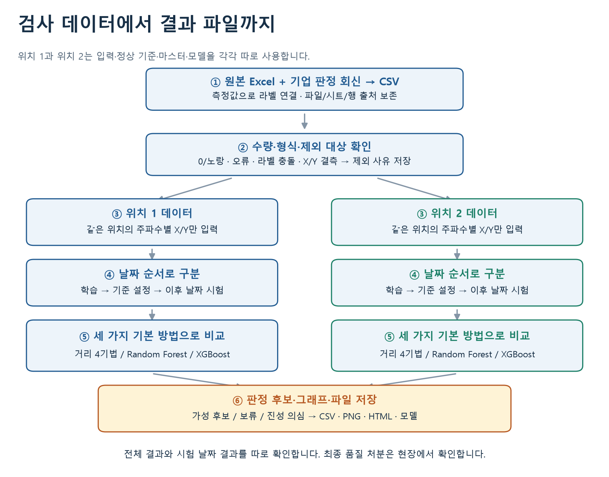
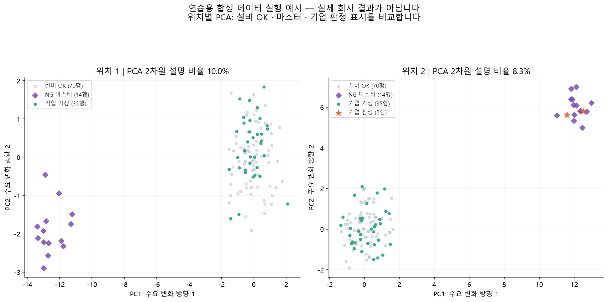
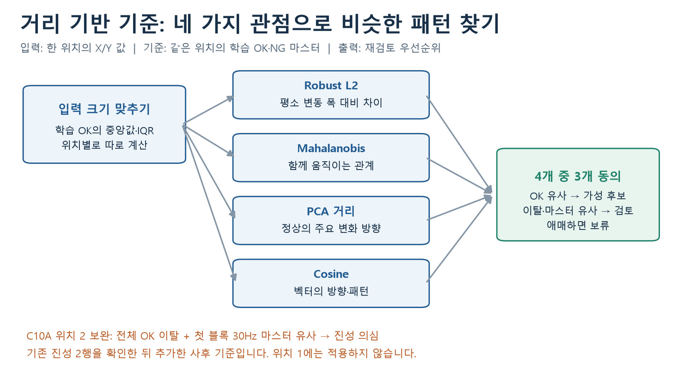
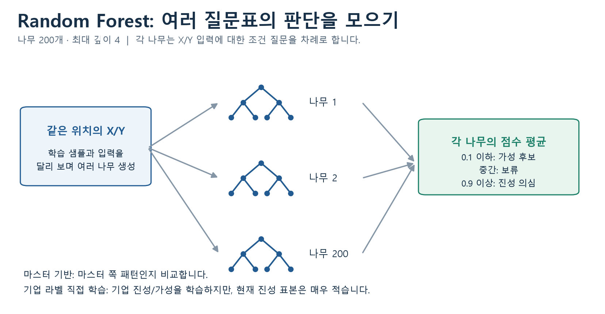
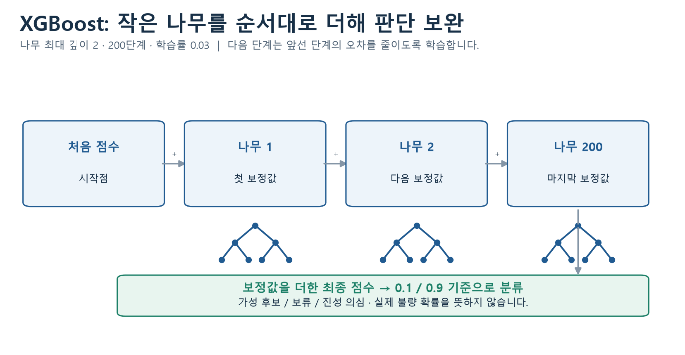
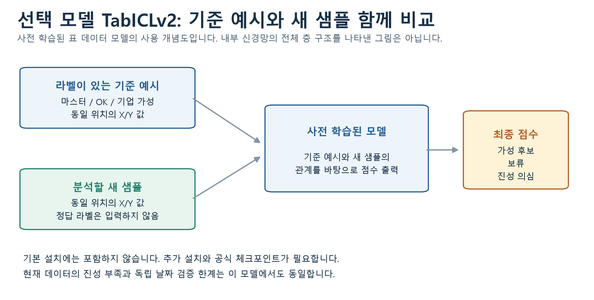
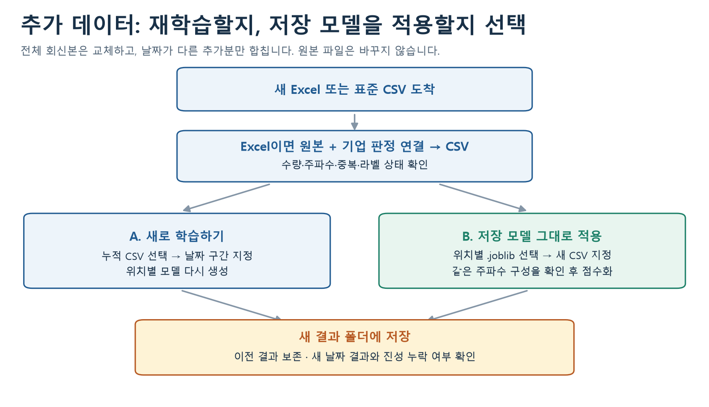

# 한국무브넥스 ECT 분석

ECT 검사기의 X/Y 측정값과 기업 판정을 비교하는 프로그램입니다. 위치 1과 위치 2를 따로 분석해 일반 NG를 가성 후보, 보류, 진성 의심으로 구분하고 결과를 표와 그래프로 저장합니다.

Windows PC에서 Jupyter 노트북으로 실행합니다. 기본 분석에는 거리 기반 기준, Random Forest, XGBoost를 사용하며 CPU로 동작합니다. TabICLv2는 선택 설치로 제공합니다.

저장소에는 실행을 익히기 위한 합성 데이터가 들어 있습니다. 실제 회사 데이터는 별도로 전달받아 사용합니다.

## 시작하기

Python 3.12가 설치된 PC라면 다음 순서로 실행할 수 있습니다.

1. 이 페이지의 `Code > Download ZIP`으로 프로그램을 내려받고 압축을 풉니다.
2. `install_windows.cmd`를 더블클릭해 설치합니다. 최초 한 번만 실행하면 됩니다.
3. `start_notebook.cmd`를 더블클릭해 Jupyter를 엽니다.
4. 01번 노트북에서 `Run > Run All Cells`를 선택합니다. 기본 설정은 연습용 데이터입니다.

처음 설치하는 경우에는 아래 [설치](#설치) 항목부터 진행합니다.

| 자료 | 내용 |
|---|---|
| [최종 정리 PPT](docs/presentations/한국무브넥스_ECT_1차분석_설치실행가이드_20261023.pptx) | 지금까지의 분석 결과와 설치·실행 안내, 26장 |
| [01. 처음부터 분석하기](notebooks/01_처음부터_분석하기.ipynb) | 데이터 확인, 모델 실행, 시각화, 결과 저장 |
| [02. 추가 데이터 변환과 재학습](notebooks/02_추가데이터_변환과_재학습.ipynb) | Excel 변환, CSV 병합, 재학습, 저장 모델 적용 |
| [추가 데이터 가이드](docs/추가데이터_가이드.md) | 파일 형식, 라벨 연결 규칙, 날짜 설정 |
| [서버 운영 가이드](docs/서버_운영가이드.md) | 서버 설치와 사용자별 실행 환경 구성 |
| [TabICLv2 안내](docs/선택모델_TabICL.md) | 선택 모델 설치와 [03번 노트북](notebooks/03_선택_TabICLv2_비교.ipynb) 실행 |

GitHub에서는 노트북 내용을 미리 볼 수 있습니다. 계산을 실행하려면 PC의 Jupyter나 담당자가 전달한 서버에 접속해야 합니다.

## 설치

### 실행 환경

- Windows 10/11 64비트
- Python 3.12 64비트와 Python Launcher
- 최초 설치 시 인터넷 연결
- 메모리 8GB 이상 권장

패키지 다운로드가 사내망에서 차단되면 전산 담당자에게 접속 환경을 확인합니다.

### Python 설치

1. [Python Windows 다운로드](https://www.python.org/downloads/windows/)에서 3.12용 64비트 설치 파일을 준비합니다.
2. 설치 화면에서 `Python Launcher`와 `Add Python to PATH`를 선택합니다.
3. 설치를 마칩니다. 이미 Python 3.12와 Launcher가 있다면 이 과정은 생략합니다.

Windows 설치 파일은 [Python 3.12.10 배포 페이지](https://www.python.org/downloads/release/python-31210/)에서도 받을 수 있습니다. 회사에서 관리하는 보안 수정 버전의 3.12 환경이 있다면 해당 환경을 사용합니다.

설치 스크립트는 `py -3.12`로 Python을 찾고 프로젝트 안에 전용 환경을 만듭니다. PC에 다른 버전의 Python이 있어도 이 환경에서 별도로 실행합니다.

### 프로그램 내려받기

이 페이지에서 `Code > Download ZIP`을 선택한 뒤, 받은 ZIP을 마우스 오른쪽 버튼으로 눌러 `모두 압축 풀기`를 실행합니다. 압축을 푼 폴더에 `README.md`, `install_windows.cmd`, `notebooks`가 있는지 확인합니다. 보관 위치는 `C:\MovenexECT`처럼 찾기 쉬운 경로를 권장합니다.

Git을 사용하는 경우에는 아래 명령으로 받을 수 있습니다.

```powershell
git clone https://github.com/barraki72268-sketch/Koreamovenex.git
cd Koreamovenex
```

### 프로그램 설치

압축을 푼 폴더에서 `install_windows.cmd`를 더블클릭합니다. Python 버전 확인, 전용 환경 생성, 패키지 설치, Jupyter 연결이 차례로 진행됩니다.

`설치 완료. start_notebook.cmd 파일을 실행하세요.`라는 문구가 나오면 설치가 끝난 것입니다. 오류가 발생하면 창에 표시된 내용을 확인하고 [문제 해결](#문제-해결)을 참고합니다.

명령으로 설치하려면 프로젝트 폴더에서 다음을 실행합니다. PowerShell 실행 정책 변경이나 가상환경 활성화는 필요하지 않습니다.

```powershell
py -3.12 -m venv .venv
.\.venv\Scripts\python.exe -m pip install -r requirements.txt
.\.venv\Scripts\python.exe -m pip check
.\.venv\Scripts\python.exe -m ipykernel install --sys-prefix --name movenex-ect --display-name "Python (Movenex ECT)"
```

## 실행

### Jupyter 열기

`start_notebook.cmd`를 더블클릭하면 브라우저에서 `01_처음부터_분석하기.ipynb`가 열립니다. 실행 환경을 묻는 창이 나오면 `Python (Movenex ECT)`를 선택합니다.

브라우저가 열리지 않으면 실행창에 표시된 `http://127.0.0.1:8888/...` 주소 전체를 복사해 접속합니다. 주소에 포함된 로그인용 문자열은 공개하지 않습니다. 작업 중에는 실행창을 열어 둡니다.

### 연습용 실행

01번 노트북의 기본 설정은 다음과 같습니다.

```python
DATA_MODE = "demo"
```

`Run > Run All Cells`를 선택하면 데이터 수량, 모델 결과, 그래프가 순서대로 표시됩니다. 마지막에 `저장 완료`가 나오면 결과 파일도 생성된 상태입니다.

연습용 데이터는 실행 과정을 확인하기 위해 만든 합성 데이터입니다. 여기서 나온 수량이나 성능을 회사 분석 결과로 사용하지 않습니다.

### 회사 데이터 실행

1. 전달받은 `C10A_49513-75270R.csv.gz`를 `data/private`에 넣습니다. `.gz` 파일은 압축을 풀지 않고 그대로 읽습니다.
2. 노트북의 ‘② 사용할 데이터 선택’에서 아래 설정을 확인합니다.

```python
DATA_MODE = "company"
PRODUCT = "C10A_49513-75270R"
```

3. `Kernel > Restart Kernel and Run All Cells…`를 선택합니다.
4. 화면에 `실제 회사 데이터입니다`라는 안내와 선택한 파일명이 표시되는지 확인합니다.

회사 데이터는 저장소에 포함하지 않습니다. 파일이 없으면 실행이 중단되므로 경로와 파일명을 확인합니다.

### 노트북 조작

노트북의 실행 칸을 셀이라고 합니다. 앞의 셀에서 읽은 데이터나 계산한 값을 다음 셀에서 사용하므로 위에서 아래로 실행합니다.

| 작업 | 조작 |
|---|---|
| 한 셀 실행 | 셀을 클릭하고 `▶` 또는 `Shift + Enter` |
| 전체 실행 | `Run > Run All Cells` |
| 실행 상태 확인 | 셀 왼쪽의 `[*]`가 숫자로 바뀌면 해당 셀 완료 |
| 설정 변경 후 재실행 | `Kernel > Restart Kernel and Run All Cells…` |
| 실행 중단 | `■` 또는 `Kernel > Interrupt Kernel` |
| 노트북 저장 | `Ctrl + S` |

종료할 때는 작업을 저장한 뒤 Jupyter 실행창에서 `Ctrl + C`를 누릅니다. 브라우저 탭만 닫으면 계산은 계속 실행될 수 있습니다.

## 분석 과정



| 단계 | 처리 내용 | 확인 사항 |
|---|---|---|
| 데이터 준비 | 원본 Excel과 기업 회신본을 연결해 CSV로 변환하거나 표준 CSV 입력 | 품번과 원본 출처 |
| 수량 점검 | 기간, 측정행 수, 주파수 구성, 결측·중복 확인 | 누락 파일과 중복 추가 여부 |
| 분석 대상 구분 | OK, 일반 NG, 마스터를 구분하고 오류·판정 불명 행 제외 | 라벨 수량과 제외 사유 |
| 위치 분리 | 위치마다 입력, 정상 기준, 마스터, 모델 구성 | 각 위치의 측정값과 라벨 사용 |
| 날짜 구분 | 학습, 기준 설정, 시험 구간 분리 | 시험 날짜의 학습 포함 여부 |
| 모델 비교 | 거리 기반 기준, Random Forest, XGBoost 실행 | 전체 결과와 시험 날짜 결과 구분 |
| 결과 확인 | 위치별 분포, 가성 구분 수, 진성 점수, 주파수별 X/Y 시각화 | 보류 수와 진성 누락 여부 |
| 저장 | 표, 그림, 모델, 설정을 실행 시각별 폴더에 저장 | HTML, CSV, PNG 파일 |

C10A 기존 결과를 재현하는 날짜 설정은 아래와 같습니다.

| 구간 | 날짜 | 용도 |
|---|---|---|
| 학습 | 2026-08-20까지 | 정상 분포와 모델 학습 |
| 기준 설정 | 2026-08-20 이후 ~ 2026-10-07 | 거리 임계값 설정 |
| 시험 | 2026-10-07 이후 | 이후 날짜의 결과 비교 |

날짜는 코드에 고정돼 있습니다. 새 CSV를 추가해도 구간이 자동으로 바뀌지 않습니다. 재학습할 때는 보유한 데이터의 날짜를 확인해 설정을 변경합니다.

## 결과 저장

01번 노트북의 ‘⑧ 결과 저장’ 셀을 실행하면 `results` 아래에 실행 시각별 폴더가 생성됩니다. 이전 결과는 그대로 남습니다.

```text
results/
└─ 실행날짜_시각/
   ├─ 결과보고서.html
   ├─ 01_위치별_결과요약.csv
   ├─ 02_행별_판정근거.csv
   ├─ 03_제외행과_이유.csv
   ├─ 04_모델별_입력중요도.csv
   ├─ 05_거리기반_상세점수.csv
   ├─ 01_PCA_위치별_분포.png
   ├─ 02_전체NG_가성구분.png
   ├─ 03_시험날짜_가성구분.png
   ├─ 04_진성행_점수.png
   ├─ 05_주파수_XY_비교.png
   ├─ 실행설정과_이력.json
   └─ models/
      ├─ p1_master_proxy_RandomForest.joblib
      ├─ p2_master_proxy_XGBoost.joblib
      └─ ...
```

| 파일 | 내용과 용도 |
|---|---|
| `결과보고서.html` | 표와 그래프를 함께 확인하는 보고서. 브라우저로 열기 |
| `01_위치별_결과요약.csv` | 위치별·모델별 판정 수량. Excel로 열기 |
| `02_행별_판정근거.csv` | 원본 시트·행, 위치, 모델 점수, 판정, 학습 포함 여부 |
| `03_제외행과_이유.csv` | 0·노란색, 오류, 라벨 확인, 결측 등 제외 사유 |
| `04_모델별_입력중요도.csv` | 모델이 학습에 사용한 X/Y 입력의 중요도 |
| `05_거리기반_상세점수.csv` | 거리 기법별 점수와 기준 대비 비율 |
| `.png` | 보고서나 PowerPoint에 넣을 그래프 |
| `실행설정과_이력.json` | 입력 파일 해시, 날짜 구간, 패키지 버전과 실행 설정 |
| `models/p1_...`, `models/p2_...` | 위치별 학습 모델. 02번 노트북에서 새 데이터에 적용 |

CSV는 Excel에서 한글을 읽을 수 있도록 UTF-8 형식으로 저장합니다. 행별 결과의 `positive_score`는 모델 점수, `decision`과 `판정`은 분류 결과입니다.

`Ctrl + S`는 노트북 저장입니다. 분석 파일을 만들려면 마지막 저장 셀까지 실행해야 합니다. HTML 보고서를 전달할 때는 그래프 PNG도 필요하므로 결과 폴더 전체를 압축해 전달합니다.

서버에서 실행한 결과는 서버의 `results`에 저장됩니다. Jupyter 왼쪽 파일 목록에서 파일을 오른쪽 클릭하고 `Download`를 선택해 내려받습니다. 폴더 단위 전달이 필요하면 서버 담당자에게 압축을 요청합니다.

## 시각화

아래는 합성 데이터로 실행한 예시입니다. 실제 회사 데이터의 분포나 성능을 나타내지는 않습니다.



### PCA 분포

여러 X/Y 입력을 두 축으로 줄여 위치별로 표시합니다. 색상은 설비 판정과 기업 라벨을 구분합니다.

| 표시 | 데이터 |
|---|---|
| 회색 | 설비 OK |
| 보라색 | NG 마스터 |
| 초록색 | 기업 가성 |
| 주황색 별 | 기업 진성 |
| 노란색 | 기업 판정 미확인 NG |

PCA는 분포를 살펴보기 위한 시각화입니다. 두 축의 거리가 실제 판정을 결정하는 것은 아니며, 모델은 원래의 X/Y 입력으로 계산합니다. PCA 축에는 원래 X/Y 단위가 적용되지 않습니다.

### 가성 구분 수

기업 가성으로 표시된 NG가 모델에서 가성 후보, 보류, 진성 의심으로 몇 행씩 나뉘는지 보여 줍니다.

전체 NG 그래프에는 학습에 사용한 행도 들어 있습니다. 학습 이후의 결과는 시험 날짜 NG 그래프에서 별도로 확인합니다. 가성 구분 수와 함께 진성을 가성 후보로 보낸 행이 있는지도 봅니다.

### 진성 행의 모델 점수

마스터 기반 모델에서 기업 진성 행이 받은 점수를 표시합니다. 현재 분류 기준은 다음과 같습니다.

| 점수 | 분류 |
|---|---|
| 0.1 이하 | 가성 후보 |
| 0.1 초과 ~ 0.9 미만 | 보류 |
| 0.9 이상 | 진성 의심 |

점수는 보정된 실제 불량 확률이 아닙니다. 기업 라벨 직접 학습에 사용한 진성 2행의 재분류 결과도 독립 검증과 구분합니다.

### 주파수별 X/Y

노트북에서 아래 값을 바꾸면 해당 위치·블록·주파수의 원래 측정값을 확인할 수 있습니다.

```python
POSITION = 2
BLOCK = 1
FREQUENCY = "30.0Hz"
```

블록 1~3은 원본 파일의 8슬롯 단위 묶음입니다. 실제 설비 채널과의 대응은 추가 확인이 필요합니다. 선택한 주파수가 해당 위치에 없으면 실행을 중단하고 안내를 표시합니다.

### 입력 중요도

Random Forest와 XGBoost가 학습에 사용한 X/Y 입력의 중요도를 CSV로 저장합니다. 중요도는 모델의 판단을 살펴보는 지표이며, 불량의 물리적 원인이나 인과관계를 뜻하지 않습니다.

## 모델 설명

### 입력과 출력

입력은 한 위치에서 측정한 주파수별 X/Y 값입니다. 현재 C10A는 위치 1에 36개, 위치 2에 42개 입력을 사용합니다. 날짜, 색상, 판정명, 카운터, 원본 행 번호와 최대측정값은 모델 입력에서 제외합니다.

위치마다 정상 데이터와 마스터, 기업 라벨을 따로 사용합니다. 출력은 가성 후보, 보류, 진성 의심입니다.

### 거리 기반 기준



학습 OK와 마스터를 기준으로 NG의 유사성과 이탈 정도를 계산합니다. 네 가지 거리 기법으로 비교한 뒤 세 기법 이상이 동의하는지 확인합니다.

| 방법 | 비교 기준 |
|---|---|
| Robust L2 | 학습 OK의 중앙값·IQR로 크기를 맞춘 뒤 RMS 거리 계산 |
| Shrink Mahalanobis | 정상 입력들이 함께 움직이는 관계를 반영해 거리 계산 |
| PCA 거리 | 정상 변화량의 95%를 담는 축에서 거리 계산 |
| Cosine | 크기를 정규화한 입력 벡터의 방향 비교 |

OK와 유사한 NG는 가성 후보로 분류하고, 기준이 엇갈리는 행은 보류합니다. OK와 마스터 양쪽에서 떨어져 있는 행을 가성으로 단정하지 않습니다.

C10A 위치 2에는 전체 신호의 OK 분포 이탈과 첫 블록 30Hz의 마스터 유사성을 함께 보는 보완 규칙을 적용합니다. 기존 진성 2행을 확인한 뒤 정한 기준으로, 위치 1이나 다른 품번에는 적용하지 않습니다.

### Random Forest



입력값에 조건을 적용하는 여러 결정나무를 학습하고, 각 나무의 분류 점수를 평균합니다. 현재 설정은 나무 200개, 최대 깊이 4입니다. 최종 점수에 0.1과 0.9 기준을 적용해 가성 후보, 보류, 진성 의심으로 나눕니다.

모델 원리는 [scikit-learn 공식 문서](https://scikit-learn.org/stable/modules/ensemble.html#forest)를 참고할 수 있습니다. 그림은 이 코드의 설정에 맞춰 작성했습니다.

### XGBoost



앞 단계의 오차를 줄이는 작은 결정나무를 순서대로 추가합니다. 현재 설정은 최대 깊이 2, 200단계이며 최종 점수에 같은 0.1과 0.9 기준을 적용합니다.

모델 원리는 [XGBoost 공식 문서](https://xgboost.readthedocs.io/en/stable/tutorials/model.html)에 설명돼 있습니다. 그림은 이번 구현을 기준으로 작성했습니다.

### 학습 데이터 구분

| 방식 | 학습 데이터 | 해석 |
|---|---|---|
| 마스터 기반 `master_proxy` | NG 마스터와 설비 OK·학습 날짜의 기업 가성 | 마스터와 유사한 패턴을 학습. 기업 진성 및 같은 사건그룹은 학습 제외 |
| 기업 라벨 직접 학습 `company_direct` | 기업 진성과 기업 가성 | 위치 1은 진성이 없어 생략. 위치 2의 진성 2행은 학습에 포함 |

직접 학습한 진성 2행을 다시 맞춘 결과만으로 새 진성의 검출 성능을 판단할 수는 없습니다. 노트북과 결과 CSV에서 학습 포함 여부와 시험 날짜를 구분해 확인합니다.

### TabICLv2



여러 표 데이터로 사전 학습한 모델에 기준 샘플과 분석할 샘플을 함께 넣어 점수를 계산합니다. 위 그림은 프로그램의 사용 흐름을 나타낸 개념도입니다.

기본 실행에는 포함하지 않습니다. 추가 비교가 필요한 경우 [선택 모델 안내](docs/선택모델_TabICL.md)에 따라 설치합니다. 원본 코드는 [TabICL 공식 저장소](https://github.com/soda-inria/tabicl)에서 확인할 수 있습니다.

OFA-TAD는 코드와 구조를 검토한 단계로, 이 배포본의 실행 및 성능 비교에는 포함하지 않았습니다.

## 추가 데이터 처리



02번 노트북에서 Excel 변환, CSV 병합, 재학습과 저장 모델 적용을 진행합니다.

| 받은 자료 또는 작업 | 처리 방법 |
|---|---|
| 원본 Excel과 기업 판정 회신본 | ①~②에서 표준 CSV 생성 |
| 이전 기간을 포함한 전체 회신본 | 새 CSV로 교체. 기존 CSV에 다시 합치지 않음 |
| 날짜가 다른 추가분 CSV | ③에서 기존 CSV와 병합 |
| 기존 행의 라벨 수정본 | 수정된 CSV로 교체한 뒤 재학습 |
| 모델 재학습 | ④에서 입력 CSV와 학습·기준 설정 날짜 지정 |
| 기존 모델로 새 데이터 분석 | ⑤에서 위치별 모델과 새 CSV 지정 |

파일 형식과 라벨 연결 규칙은 [추가 데이터 가이드](docs/추가데이터_가이드.md)에 정리돼 있습니다. 주파수 구성이 달라졌다면 품번과 설비 조건을 확인하고 데이터를 나눠 학습합니다.

## 분석 범위와 한계

이번 배포본은 C10A의 위치별 거리 보완 기준과 RF·XGBoost 비교를 재현하도록 구성했습니다. 다른 품번도 같은 형식의 CSV로 수량과 분포를 확인할 수 있지만, 학습·검증 조건은 품번별로 검토해야 합니다.

진성·가성 라벨은 기업 회신 Excel의 표시를 따릅니다. 파괴검사 등 독립적인 최종 판정 여부는 확인되지 않았습니다. C10A 진성은 위치 2의 2개 측정행이며 날짜와 카운터가 같아 독립 제품 수가 확인되지 않았습니다. 시험 날짜에는 기업 진성이 없어 새 날짜의 진성 검출률을 평가할 수 없습니다.

추가 검증에는 다른 날짜의 진성, 재검사·최종 처분 결과, 제품을 구분할 검사 ID와 부위 정보가 필요합니다. 현재 결과는 현장 재검토의 우선순위를 정하는 참고자료로 사용합니다.

## 문제 해결

| 증상 | 확인 사항 |
|---|---|
| Python 3.12를 찾지 못함 | Python 3.12 64비트와 Launcher 설치 후 `install_windows.cmd` 재실행 |
| 설치 중 다운로드 실패 | 인터넷과 사내 프록시 확인. 화면에 표시된 오류를 담당자에게 전달 |
| DLL 로드 오류 | Windows 업데이트와 [Microsoft Visual C++ x64 런타임](https://learn.microsoft.com/en-us/cpp/windows/latest-supported-vc-redist) 설치 상태 |
| 브라우저가 열리지 않음 | 실행창에 표시된 로그인 URL 전체로 접속 |
| 다른 Python 환경으로 실행됨 | 커널을 `Python (Movenex ECT)`로 변경 |
| `NameError` | 커널 재시작 후 첫 셀부터 전체 실행 |
| CSV 파일을 찾지 못함 | `data/private` 경로, `PRODUCT`, 파일명과 확장자 |
| 학습 OK나 마스터 부족 | 지정한 날짜 구간의 데이터 수량 |
| 주파수 구성 오류 | 품번과 설비 조건이 다른 자료의 혼합 여부 |
| 중복 행 오류 | 전체 회신본을 추가분으로 다시 합쳤는지 확인 |
| 8888 포트 사용 중 | 기존 Jupyter 실행창 확인. 다른 포트로 열렸다면 표시된 URL 사용 |
| CSV 한글이 깨짐 | Excel 데이터 가져오기에서 UTF-8 선택 |
| Linux에서 한글이 네모로 표시됨 | Noto Sans CJK 등 한글 글꼴 설치 후 커널 재시작 |

## 폴더 구성

```text
Koreamovenex/
├─ README.md
├─ install_windows.cmd           # 최초 설치
├─ start_notebook.cmd            # Jupyter 실행
├─ requirements.txt              # 기본 패키지 목록
├─ notebooks/                    # 실행 노트북
├─ ectlab/                       # 분석 코드
├─ docs/                         # 가이드, 그림, 최종 PPT
├─ data/
│  ├─ demo/                      # 합성 연습 데이터
│  ├─ private/                   # 별도 전달받은 회사 CSV
│  ├─ raw/                       # 회사 원본·회신 Excel
│  └─ processed/                 # 변환한 CSV
├─ results/                      # 실행 결과
├─ scripts/                      # 명령행 실행 도구
└─ tests/                        # 분리 규칙과 실행 점검
```

회사 데이터와 실행 결과, 학습 모델은 Git에서 제외합니다. 원본 파일은 변경하지 않으며 변환한 CSV와 결과는 별도로 저장합니다.

## 명령행 실행

노트북 대신 명령으로 분석하거나 Excel을 변환할 때 사용합니다.

```powershell
.\.venv\Scripts\python.exe scripts/run_analysis.py --input "data/private/C10A_49513-75270R.csv.gz"
.\.venv\Scripts\python.exe scripts/convert_excel.py --original "data/raw/original/C10A_49513-75270R.xlsx" --returned "data/raw/returned/C10A_49513-75270R.xlsx" --output "data/processed/C10A_49513-75270R.csv.gz"
.\.venv\Scripts\python.exe -m unittest discover -s tests -v
```

관련 문서: [JupyterLab 노트북 사용법](https://jupyterlab.readthedocs.io/en/stable/user/notebook.html), [PCA](https://scikit-learn.org/stable/modules/decomposition.html#pca).
