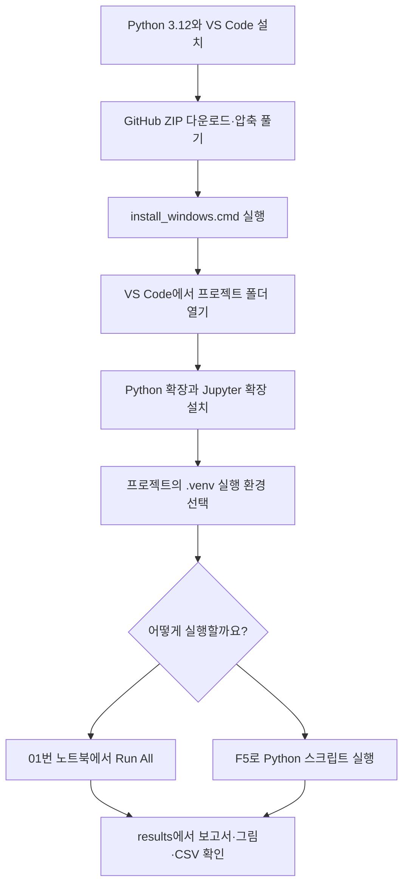

# Windows에서 VS Code와 Python으로 실행하기

내 PC에 프로그램을 설치하고 분석하는 방법입니다. 서버 접속이나 Docker 설치는 필요하지 않습니다. 처음에는 연습용으로 실행을 확인하고, 실제 회사 CSV를 넣어 분석합니다.

아래 1~8단계는 Visual Studio Code(VS Code) 기준입니다. Visual Studio IDE를 사용 중이라면 공통 설치 후 [Visual Studio에서 실행](#visual-studio에서-실행)을 참고합니다. 두 프로그램의 실행 환경 선택 메뉴는 서로 다릅니다.

## 빠른 순서



## 1. Python과 VS Code 설치

준비물은 Windows 10/11 64비트 PC, 인터넷 연결, Python 3.12 64비트와 VS Code입니다. 메모리는 8GB 이상을 권장합니다.

1. [Python Windows 다운로드](https://www.python.org/downloads/windows/)에서 Python 3.12용 64비트 설치 파일을 받습니다. Windows 설치 파일은 [3.12.10 배포 페이지](https://www.python.org/downloads/release/python-31210/)에서도 받을 수 있습니다. 회사가 관리하는 Python 3.12 환경이 있으면 해당 환경을 사용합니다.
2. 설치할 때 `Python Launcher`와 `Add Python to PATH`를 선택합니다.
3. [VS Code](https://code.visualstudio.com/Download)를 설치합니다.
4. 이미 설치돼 있다면 다음 단계로 넘어갑니다.

Python 버전 확인이 필요하면 PowerShell에서 다음을 실행합니다.

```powershell
py -3.12 --version
```

`Python 3.12.x`가 표시되면 됩니다. `python` 명령이 다른 버전을 가리킬 수 있어 여기서는 버전을 명시합니다.

## 2. 프로그램 다운로드와 최초 설치

1. [GitHub 저장소](https://github.com/barraki72268-sketch/Koreamovenex)에서 `Code > Download ZIP`을 선택합니다.
2. ZIP 파일을 오른쪽 클릭하고 `모두 압축 풀기`를 선택합니다.
3. 압축을 푼 폴더 안에 `README.md`, `requirements.txt`, `install_windows.cmd`, `notebooks`, `scripts`가 있는지 확인합니다.
4. `install_windows.cmd`를 더블클릭합니다.
5. `설치 완료. start_notebook.cmd 파일을 실행하세요.`가 나오면 아무 키나 눌러 창을 닫습니다. VS Code로 실행할 때는 `start_notebook.cmd`를 따로 실행하지 않아도 됩니다.

설치 스크립트는 이 폴더의 `.venv` 안에 분석 패키지를 설치하고 Jupyter 커널을 등록합니다. PC 전체의 Python 환경과 구분해 사용합니다. 설치 중에는 패키지를 내려받으므로 창을 닫지 않습니다.

Git을 사용하는 분은 ZIP 대신 다음 명령으로 받을 수 있습니다.

```powershell
git clone https://github.com/barraki72268-sketch/Koreamovenex.git
cd Koreamovenex
.\install_windows.cmd
```

## 3. VS Code에서 폴더 열기

1. VS Code를 실행합니다.
2. `File > Open Folder…`(파일 > 폴더 열기)를 선택합니다.
3. 2단계에서 압축을 푼 프로젝트 폴더를 선택합니다. `notebooks`만 열지 말고 `README.md`와 `requirements.txt`가 있는 폴더를 엽니다.
4. 신뢰 여부를 묻는 화면이 나오면 다운로드한 저장소의 주소와 폴더를 확인한 뒤, 신뢰하는 경우 작업 영역 신뢰를 선택합니다.

왼쪽 탐색기에 `notebooks`, `scripts`, `ectlab`, `.vscode`가 표시되면 올바른 폴더를 연 것입니다.

## 4. 확장 설치

왼쪽 확장 메뉴 또는 `Ctrl + Shift + X`에서 아래 확장을 검색해 설치합니다. 게시자가 Microsoft인지 확인합니다.

| 확장 | 검색 ID | 용도 |
|---|---|---|
| [Python](https://marketplace.visualstudio.com/items?itemName=ms-python.python) | `ms-python.python` | Python 실행 환경 선택과 코드 실행 |
| [Jupyter](https://marketplace.visualstudio.com/items?itemName=ms-toolsai.jupyter) | `ms-toolsai.jupyter` | `.ipynb` 노트북 실행과 그래프 표시 |
| [Python Debugger](https://marketplace.visualstudio.com/items?itemName=ms-python.debugpy) | `ms-python.debugpy` | 아래 F5 실행 설정 사용 |

저장소의 `.vscode/extensions.json`에도 이 목록을 넣었습니다. 권장 확장 안내가 나오면 같은 목록을 설치하면 됩니다. 확장 설치 뒤 다시 로드를 요청하면 진행합니다.

## 5. 프로젝트의 Python 선택

1. `Ctrl + Shift + P`를 누릅니다.
2. `Python: Select Interpreter`를 검색해 선택합니다.
3. 프로젝트의 `.venv` 환경을 선택합니다.
4. 목록에 없으면 `Enter interpreter path… > Find…`를 선택하고 아래 파일을 직접 지정합니다.

```text
프로젝트 폴더\.venv\Scripts\python.exe
```

예를 들어 프로젝트가 `C:\MovenexECT`이면 `C:\MovenexECT\.venv\Scripts\python.exe`입니다. `install_windows.cmd`를 실행한 폴더의 파일을 선택해야 합니다.

`.vscode/settings.json`은 `.venv`를 기본 환경으로 찾도록 지정합니다. 다른 환경이 이미 선택된 PC에서는 위 메뉴로 직접 바꿉니다. 노트북의 커널은 다음 단계에서 별도로 선택합니다.

이 가이드는 가상환경 활성화 명령을 사용하지 않습니다. PowerShell 실행 정책을 바꿀 필요도 없습니다. 터미널에서는 `python` 대신 `.\.venv\Scripts\python.exe`의 명시적 경로를 사용합니다.

## 6. 노트북으로 실행하기

### 연습용으로 먼저 확인

1. 왼쪽에서 `notebooks/01_처음부터_분석하기.ipynb`를 엽니다.
2. 오른쪽 위 `Select Kernel`(커널 선택)을 누릅니다.
3. 목록에 `Python (Movenex ECT)`가 보이면 선택합니다. 없으면 `Select Another Kernel… > Python Environments…`에서 프로젝트의 `.venv`를 선택합니다. 메뉴 이름은 버전에 따라 조금 다를 수 있습니다.
4. ② 데이터 선택 셀은 기본값 그대로 둡니다. PC 기본값은 합성 연습 데이터입니다.
5. 노트북 위쪽 `Run All`(모두 실행)을 누릅니다. 한 셀씩 보려면 셀 왼쪽 `▶` 또는 `Shift + Enter`를 사용합니다.
6. 준비, 수량 점검, 날짜 구분, 거리 기준, RF·XGBoost, 그래프, 저장 순으로 실행됩니다.
7. 마지막에 `저장 완료`가 표시되는지 확인합니다.

연습용 결과는 사용법 확인용입니다. 실제 회사의 성능 결과로 사용하지 않습니다. 화면에 `연습용 합성 데이터입니다`라는 안내가 표시됩니다.

### 실제 회사 CSV로 실행

실제 CSV는 담당자에게 별도로 받아 PC에 넣어야 합니다. GitHub ZIP에는 회사 데이터가 포함돼 있지 않습니다. 서버에서 사용하던 CSV도 로컬 PC에서는 별도로 준비해야 합니다.

개별 전달된 실행 서버에 접근 권한이 있다면, 웹 Jupyter의 왼쪽 파일 목록에서 `data > private`를 열고 해당 CSV를 오른쪽 클릭해 `Download`로 받을 수 있습니다. 다운로드한 파일을 아래의 로컬 프로젝트 폴더에 넣습니다. 인증 링크나 회사 CSV를 공개 저장소에 올리지 않습니다.

1. 프로젝트 안에 `data/private` 폴더를 준비합니다. 최초 설치 스크립트가 이 폴더를 만듭니다.
2. `C10A_49513-75270R.csv.gz`를 넣습니다. `.gz`는 압축을 풀지 않습니다.
3. 01번 노트북의 ② 셀에서 `DATA_MODE`와 `PRODUCT` 대입 줄을 다음과 같이 바꿉니다. 나머지 코드는 그대로 둡니다.

```python
DATA_MODE = "company"
PRODUCT = "C10A_49513-75270R"
```

4. `Restart`(커널 다시 시작)를 선택한 뒤 `Run All`로 처음부터 실행합니다.
5. 화면에 `실제 회사 데이터입니다`와 올바른 파일명이 표시되는지 확인합니다.
6. 마지막 저장 셀까지 완료됐는지 확인합니다.

기본 노트북은 Python의 환경변수 설정도 읽습니다. 일반 Windows PC에서는 위 두 줄을 직접 지정하면 됩니다. 기존에 `ECT_CSV_PATH`를 설정한 PC라면 그 경로가 우선하므로 선택된 파일명을 확인하고, 필요하면 ② 셀의 `DATA_PATH`를 직접 지정합니다.

```python
DATA_PATH = ROOT / "data/private/C10A_49513-75270R.csv.gz"
```

위치 1·2는 따로 학습하고 평가합니다. 추가 날짜를 학습에 쓰려면 ④의 학습 종료일·기준 설정 종료일도 바꿔야 합니다. 날짜가 자동 갱신되지는 않습니다.

## 7. .py 파일로 실행하기

노트북 대신 `scripts/run_analysis.py`를 Python으로 실행할 수도 있습니다. 거리 기준과 RF·XGBoost 분석 후 표·그림·모델을 파일로 저장합니다.

### F5로 실행

저장소의 `.vscode/launch.json`에 연습용과 회사 데이터용 설정을 넣었습니다.

1. 왼쪽 `Run and Debug`(실행 및 디버그) 또는 `Ctrl + Shift + D`를 엽니다.
2. 위쪽 실행 목록에서 `1. 연습용 CSV 분석 (Windows)`를 선택합니다.
3. `F5`를 누릅니다. 노트북 파일을 열지 않아도 됩니다.
4. 하단 터미널에 위치별 수량과 모델 학습 결과가 표시되고, 마지막에 `저장 완료`와 결과 경로가 나옵니다.
5. 실제 CSV를 준비했다면 `2. 실제 회사 CSV 분석 (Windows)`로 바꿔 `F5`를 누릅니다.

이 설정은 설치한 `.venv\Scripts\python.exe`, 프로젝트 폴더, 입력 CSV와 날짜를 지정해 실행합니다. 입력 파일이나 학습 날짜를 바꾸려면 `.vscode/launch.json`의 해당 실행 항목에서 `--input`, `--train-end`, `--calibration-end` 뒤의 값을 수정합니다.

`run_analysis.py`만 열고 오른쪽 위 일반 실행 버튼을 누르면 `--input`이 없다는 오류가 날 수 있습니다. 위 실행 목록의 F5 설정 또는 아래 터미널 명령을 사용합니다.

### 터미널에서 실행

`Terminal > New Terminal`로 PowerShell을 열고 프로젝트 폴더에서 실행합니다. 아래 명령은 한 줄 전체를 복사합니다.

연습용:

```powershell
.\.venv\Scripts\python.exe scripts/run_analysis.py --input "data/demo/연습용_ECT.csv.gz"
```

실제 회사 데이터:

```powershell
.\.venv\Scripts\python.exe scripts/run_analysis.py --input "data/private/C10A_49513-75270R.csv.gz"
```

추가 데이터를 학습할 때는 실제 보유 날짜에 맞게 구간을 정합니다. 예를 들어 다음 명령의 날짜는 사용법을 설명하기 위한 예시입니다. 기존 C10A 결과를 재현하려면 기본 날짜인 2026-08-20, 2026-10-07을 사용합니다.

```powershell
.\.venv\Scripts\python.exe scripts/run_analysis.py --input "data/processed/추가데이터_누적.csv.gz" --train-end "2026-10-07" --calibration-end "2026-10-10"
```

시험 날짜를 학습·기준 설정 구간 이후에 남겨 둡니다. 새 진성 데이터가 없다면 새 날짜의 진성 검출률을 평가할 수 없다는 점은 같습니다.

## 8. 결과 보기와 전달

완료되면 프로젝트의 `results` 아래에 실행 시각별 폴더가 생깁니다. 왼쪽 탐색기에 보이지 않으면 새로 고침합니다.

| 확인할 것 | 파일과 여는 방법 |
|---|---|
| 표·그래프를 함께 보기 | `결과보고서.html`을 Windows 파일 탐색기에서 더블클릭 |
| 수량과 판정 근거 | `01_위치별_결과요약.csv`, `02_행별_판정근거.csv`를 Excel로 열기 |
| 보고서에 넣을 그림 | 같은 폴더의 `.png` 파일 |
| 다시 적용할 모델 | `models` 안의 위치별 `.joblib` |
| 재현 설정 | `실행설정과_이력.json` |

01번 노트북은 그래프 5종을 만들고 주파수별 X/Y도 선택해 볼 수 있습니다. 기본 `.py` 실행은 그중 PCA·전체 NG·시험 날짜 NG·진성 점수의 4종을 저장합니다. 분석 보고서가 화면에 자동으로 뜨지는 않으므로 저장된 HTML을 직접 엽니다.

노트북의 `Ctrl + S`는 노트북 저장입니다. 분석 결과를 별도 파일로 만들려면 마지막 저장 셀까지 실행해야 합니다. HTML을 전달할 때는 그래프도 필요하므로 결과 폴더 전체를 압축합니다.

추가 원본을 CSV로 변환하거나 CSV를 병합하려면 [02번 노트북](../notebooks/02_추가데이터_변환과_재학습.ipynb)과 [추가 데이터 가이드](추가데이터_가이드.md)를 사용합니다.

## Visual Studio에서 실행

Visual Studio IDE를 이미 사용 중이면 다음 순서로 진행합니다. `.vscode/launch.json`은 VS Code용 설정이므로 Visual Studio IDE에서는 그대로 사용하지 않습니다.

1. `Visual Studio Installer`에서 설치된 Visual Studio의 `Modify`(수정)를 열고 `Python development`(Python 개발) 워크로드를 설치합니다.
2. 위 1~2단계의 Python 3.12와 프로그램 설치를 완료합니다.
3. Visual Studio에서 `File > Open > Folder`로 프로젝트 폴더를 엽니다.
4. `View > Other Windows > Python Environments`에서 기존 환경을 추가하고, 프로젝트의 `.venv\Scripts\python.exe`를 사용하도록 선택합니다. 버전에 따라 환경 선택은 Python 환경 도구 모음에 표시됩니다.
5. 우선 PowerShell에서 7단계의 명령으로 실행해 CSV와 패키지가 준비됐는지 확인합니다.
6. 솔루션 탐색기에서 `scripts/run_analysis.py`를 오른쪽 클릭하고 `Set as Startup Item`(시작 항목으로 설정)을 선택합니다.
7. 같은 파일을 다시 오른쪽 클릭하고 `Add Debug Configuration`(디버그 구성 추가)에서 Python의 기본 디버거를 선택합니다. 숨겨진 `.vs` 폴더의 `launch.vs.json`이 열립니다.
8. 생성된 실행 항목에서 `scriptArguments`와 `workingDirectory`를 다음 값으로 지정합니다. 나머지 생성된 설정은 유지합니다.

```json
"scriptArguments": "--input \"data/private/C10A_49513-75270R.csv.gz\"",
"workingDirectory": "."
```

9. Python 환경 도구 모음에서 이 프로젝트의 `.venv`가 선택됐는지 확인하고, `Debug > Start Without Debugging` 또는 `Ctrl + F5`로 실행합니다. 인수에 들어가는 실제 명령은 다음과 같습니다.

```text
--input "data/private/C10A_49513-75270R.csv.gz"
```

처음에는 입력 경로를 `data/demo/연습용_ECT.csv.gz`로 바꿔 확인할 수 있습니다. Visual Studio 버전별 환경·시작 항목 설정은 [폴더의 Python 코드 실행](https://learn.microsoft.com/en-us/visualstudio/python/quickstart-05-python-visual-studio-open-folder)과 [Python 환경 관리](https://learn.microsoft.com/en-us/visualstudio/python/managing-python-environments-in-visual-studio)를 참고합니다. 노트북을 셀 단위로 보고 실행하려면 앞에서 설명한 VS Code 경로를 이용합니다.

## 자주 막히는 부분

| 증상 | 확인할 것 |
|---|---|
| `py` 또는 Python 3.12를 찾지 못함 | Python 3.12 64비트와 Launcher 설치 후 터미널 다시 열기 |
| `.venv\Scripts\python.exe`가 없음 | 프로젝트 폴더에서 `install_windows.cmd`가 완료됐는지 |
| 확장 또는 커널 목록이 없음 | Microsoft Python·Jupyter 확장 설치, 창 다시 로드 |
| `ModuleNotFoundError` | ⑤의 인터프리터와 노트북 커널 모두 해당 프로젝트의 `.venv`인지 |
| F5 목록에 제공한 항목이 없음 | `scripts`가 아닌 `.vscode`가 포함된 프로젝트 루트를 열었는지 |
| `--input`이 필요하다는 오류 | 일반 실행 버튼 대신 제공한 F5 항목 또는 인수가 포함된 명령 사용 |
| 회사 CSV를 찾지 못함 | `data/private`, 파일명·확장자·대소문자 확인 |
| 연습용 결과가 나옴 | 노트북 `DATA_MODE` 또는 F5 실행 항목이 실제 회사 데이터용인지 |
| `NameError` | 커널을 다시 시작하고 첫 셀부터 전체 실행 |
| PowerShell 활성화 오류 | 활성화 없이 `.\.venv\Scripts\python.exe`로 실행. 실행 정책 변경 불필요 |
| VS Code 안에서 HTML이 소스 코드로 보임 | Windows 파일 탐색기에서 HTML 더블클릭 |
| 코드 수정 후 결과가 그대로임 | 커널 재시작·전체 실행 후 새 결과 폴더 확인 |

공식 안내: [VS Code의 Python](https://code.visualstudio.com/docs/languages/python), [노트북 커널 선택](https://code.visualstudio.com/docs/datascience/jupyter-kernel-management), [Python 디버그 설정](https://code.visualstudio.com/docs/python/debugging).
