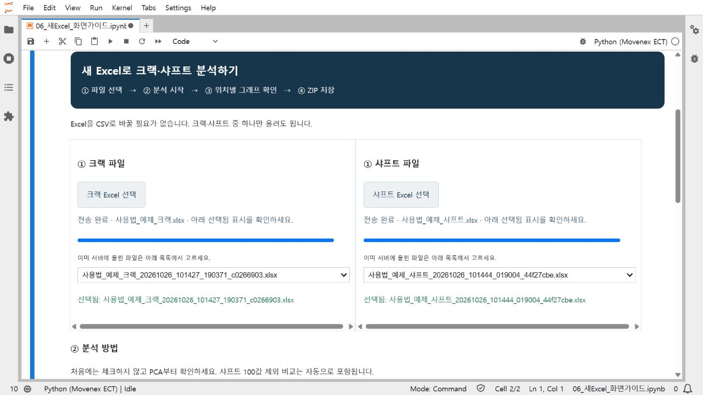
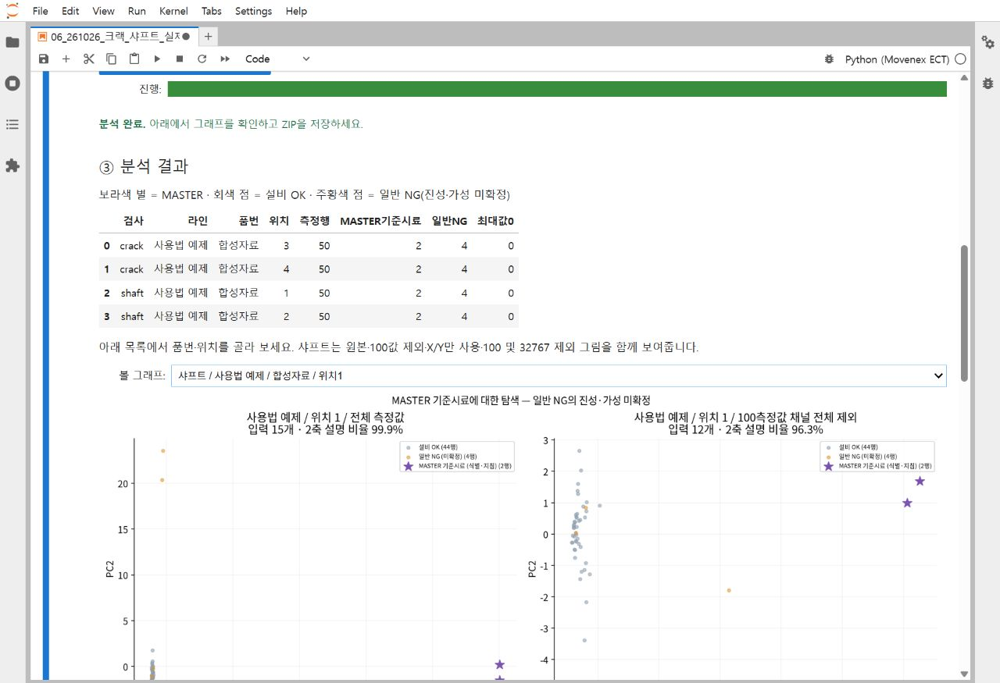
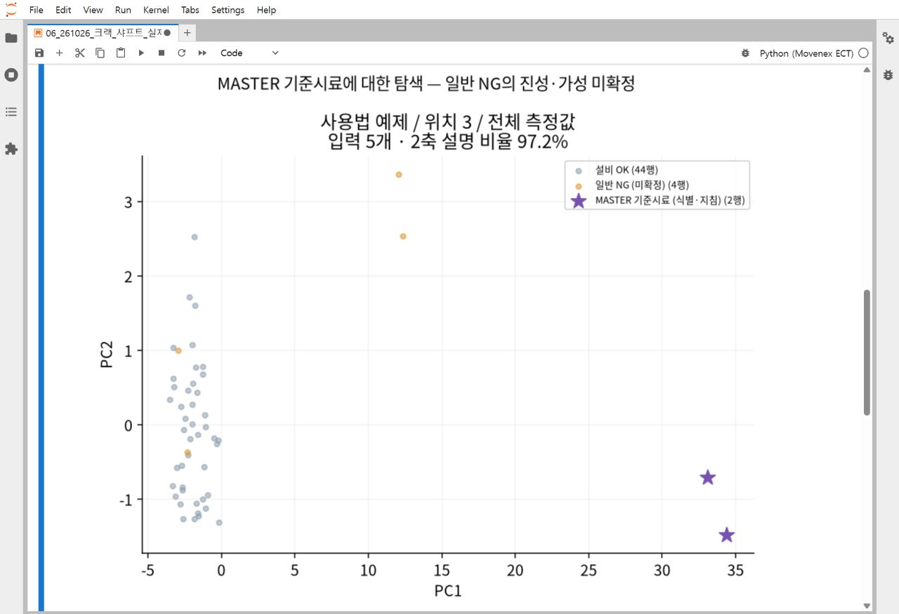
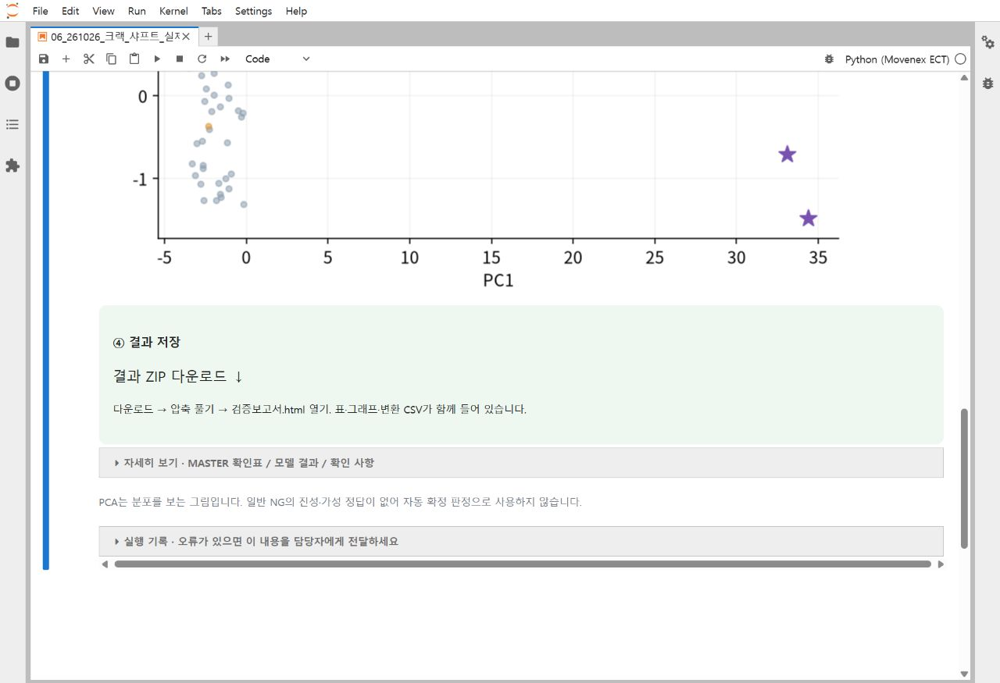

# 새 Excel 파일로 분석하기

받은 크랙·샤프트 Excel을 그대로 선택하면 됩니다. 코드를 입력하거나 CSV로 변환할 필요가 없습니다.

기존 자료까지 함께 실행하거나 샘플별 거리·모델 결과를 보려면 [09번 통합 테스트 안내](통합테스트_가이드.md)를 먼저 확인하세요. 아래 사진의 파일 선택·분석·저장 버튼은 09번의 새 Excel 탭에서도 같은 순서로 사용합니다.

`06번 열기 → 전체 실행 한 번 → Excel 선택 → 분석 시작 → 위치별 그래프 → ZIP 저장`

이 문서의 스크린샷은 사용법 확인용 합성 Excel로 실제 서버에서 촬영했습니다. 회사 분석 결과가 아닙니다.

## 시작 전에

- PC의 Chrome 또는 Edge에서 담당자가 개별 전달한 인증 링크를 엽니다.
- 로그인 화면이 나오면 전달받은 토큰을 맨 위 `Password or token`에 입력합니다. 아래쪽 비밀번호 설정은 사용하지 않습니다.
- 이번 전달 형식의 `.xlsx`를 지원합니다. 크랙과 샤프트 중 하나만 있어도 됩니다. 파일당 100MB까지 선택할 수 있습니다.
- 열 배치가 다른 Excel은 담당자에게 먼저 확인합니다. 파일명만 바꾸는 것으로 형식이 바뀌지는 않습니다.

연습하려면 [크랙 합성 Excel](../data/demo/excel/사용법_예제_크랙.xlsx) 또는 [샤프트 합성 Excel](../data/demo/excel/사용법_예제_샤프트.xlsx)을 내려받아 선택합니다. GitHub 파일 화면에서는 `Download raw file`을 누릅니다. 실제 회사 데이터는 아닙니다.

## 1. 06번을 열고 전체 실행을 한 번 누릅니다

왼쪽 `notebooks`에서 `06_261026_크랙_샤프트_실제자료검증.ipynb`를 더블클릭합니다.

화면 위의 `Run`을 누른 다음 `Run All Cells`를 누릅니다. 이 동작은 파일 선택 화면을 준비합니다. 아직 회사 파일을 분석하지 않습니다.

실행 환경을 묻는 창이 나오면 `Python (Movenex ECT)`를 선택합니다. 아래에 남색 제목과 Excel 선택 버튼 두 개가 보이면 준비가 끝났습니다. 화면이 좁으면 왼쪽 폴더 아이콘을 눌러 파일 목록을 접을 수 있습니다.

## 2. 받은 Excel을 선택합니다

- 크랙 파일은 왼쪽 `크랙 Excel 선택`을 누릅니다.
- 샤프트 파일은 오른쪽 `샤프트 Excel 선택`을 누릅니다.
- 파일 선택 창에서 받은 `.xlsx`를 찾아 `열기`를 누릅니다.
- 하나만 분석할 때는 다른 쪽을 `선택 안 함`으로 둡니다.

파일이 크면 업로드가 끝날 때까지 기다립니다. 업로드 진행률이 100%가 된 뒤, 아래에 초록색 `선택됨: 파일명`이 표시되는지 확인합니다. 준비되면 파란색 분석 버튼이 켜집니다.

이미 서버에 올렸던 파일은 각 버튼 아래 목록에서 다시 고를 수 있습니다. `사용법_예제`는 합성 연습 파일이므로 실제 분석에서는 회사 파일명을 확인합니다. 같은 파일을 다시 올려도 이전 원본을 덮어쓰지 않습니다.

## 3. 분석 시작을 누릅니다

처음에는 `RF·XGBoost 모델 비교도 함께 실행`을 체크하지 않고 파란색 `② 분석 시작`을 누릅니다. PCA부터 빠르게 확인하는 방법입니다.

분석 중에는 버튼이 잠깐 잠깁니다. 완료되면 진행 막대가 초록색으로 바뀌고 `분석 완료`와 데이터 수량이 표시됩니다. 큰 Excel은 읽고 계산하는 데 시간이 걸릴 수 있습니다.

모델 결과까지 보고 싶으면 같은 파일을 선택한 상태에서 체크박스를 켜고 다시 `분석 시작`을 누릅니다. RF·XGBoost는 이전 날짜로 학습하고 마지막 날짜를 확인합니다. 날짜나 MASTER가 부족하면 해당 구간의 모델 학습은 생략합니다. GPU 모델 학습은 이 버튼에서 실행하지 않습니다.

## 4. 품번·위치를 골라 PCA를 봅니다

`③ 분석 결과` 아래 `볼 그래프` 목록에서 원하는 품번·위치를 선택합니다. 위치는 원본 번호 그대로 따로 계산합니다. 크랙의 위치 3·4를 위치 1·2로 바꾸지 않습니다.

샤프트는 다음 네 가지 그림을 함께 보여줍니다.

| 그림 제목 | 확인할 내용 |
|---|---|
| 전체 측정값 | 받은 측정값을 사용한 원래 분포 |
| 100측정값 채널 전체 제외 | 측정값 +100이 있는 주파수 채널의 X/Y·측정값을 함께 빼도 분리되는지 |
| X_Y만 사용 | X/Y만 사용했을 때의 분포 |
| 100·32767 채널 전체 제외 | 100 및 반복 상한 의심값 32767 채널까지 제외한 참고 비교 |

100값이 있는 MASTER 행 전체를 삭제하거나 100을 0으로 바꾸는 방식이 아닙니다. PCA 비교의 제외 채널은 현재 파일 전체에서 확인합니다. 모델 학습용 제외 채널은 이전 학습 날짜로 정하므로 두 기준은 다를 수 있습니다.

크랙은 필터별 측정값으로 계산한 PCA를 표시합니다.

| 표시 | 뜻 |
|---|---|
| 보라색 별 | MASTER 기준시료 |
| 회색 점 | 설비 OK |
| 주황색 점 | 일반 NG. 진성·가성 미확정 |

점들이 모이는 위치와 MASTER·OK의 관계를 봅니다. PCA 그림만으로 일반 NG를 진성·가성으로 확정하지 않습니다. 비교 그림마다 PCA 축을 다시 계산하므로 좌표의 방향 자체를 직접 비교하지 않습니다.

크랙 MASTER는 기본 오전 6시를 검사일 경계로 사용합니다. 6시 이전 새벽 측정은 전일에 속하며, 같은 품번·위치의 당일 경계 이후 첫 측정을 MASTER 후보로 봅니다. 후보의 설비 판정이 OK이면 확인 대상으로 남기고 진성 학습 기준에서 제외합니다. 샤프트는 검사번호에 명시된 NG마스터를 우선 사용합니다. 최대측정값 0은 판정 불명으로 제외합니다. 자세한 행은 화면 아래 `자세히 보기`를 펼쳐 확인합니다.

## 5. 결과를 내려받습니다

아래쪽 `④ 결과 저장`에서 `결과 ZIP 다운로드 ↓`를 누릅니다.

1. PC의 `다운로드` 폴더에서 ZIP을 찾습니다.
2. ZIP을 오른쪽 클릭하고 `모두 압축 풀기`를 선택합니다.
3. 압축을 푼 폴더에서 `검증보고서.html`을 더블클릭합니다.

ZIP에는 보고서, 품번·위치별 PCA PNG, 수량·MASTER 확인표·PCA 좌표 CSV, 자동 변환 CSV와 실행 기준이 함께 들어 있습니다. 모델 비교를 체크했다면 행별 모델 점수와 학습 모델도 추가됩니다. 결과와 변환 CSV에도 회사 정보가 들어 있으므로 별도로 관리합니다.

## 다음 파일을 분석할 때

같은 화면 위로 올라가 새 Excel을 고른 뒤 `분석 시작`을 누르면 됩니다. 더 이상 사용하지 않을 검사는 파일 목록에서 `선택 안 함`을 고릅니다. 다른 파일로 실행하면 새 결과 폴더를 만들며, 이전에 분석한 CSV를 자동으로 섞지 않습니다. 같은 Excel을 다시 실행할 때는 원본과 변환 CSV의 해시를 확인한 뒤 변환 결과를 재사용해 대기 시간을 줄입니다. 분석 결과 자체는 다시 계산합니다.

브라우저를 새로 열었거나 버튼이 반응하지 않으면 06번에서 `Run → Run All Cells`를 한 번 눌러 화면을 다시 준비합니다. 실행 후 파일 선택은 다시 확인합니다.

## 막혔을 때

| 화면 상태 | 다음 행동 |
|---|---|
| 로그인 화면 | 개별 전달받은 토큰을 맨 위 입력란에 넣습니다. |
| Excel 버튼이 안 보임 | 06번인지 확인하고 `Run → Run All Cells`를 누릅니다. |
| 분석 버튼이 흐리게 보임 | 파일 전송이 끝나고 `선택됨`이 뜨는지 확인합니다. |
| 지원하지 않는 열 배치 | 크랙·샤프트 파일을 서로 바꿔 넣었는지 확인합니다. 맞으면 담당자에게 파일과 오류 화면을 전달합니다. |
| 모델 결과가 비어 있음 | PCA는 실행됐더라도 학습 날짜·MASTER가 부족하면 모델 비교는 생략될 수 있습니다. |
| 이미 열어둔 06번이 옛 화면 | `File → Reload Notebook from Disk`로 최신 파일을 읽고 전체 실행합니다. 파일 충돌 창에서는 `Revert`로 서버 버전을 읽습니다. |
| 다른 오류 | 아래 `실행 기록`을 펼쳐 화면을 담당자에게 전달합니다. |

## 다른 노트북은 언제 쓰나요?

| 번호 | 용도 |
|---|---|
| 05번 | 기존 ECT 표준 CSV 파일을 버튼으로 탐색 |
| 06번 | 이번 크랙·샤프트 Excel을 선택해 분석하는 기본 화면 |
| 07번 | 저장된 GPU 사전학습 모델 비교 결과 확인 |
| 08번 | 연구자용 상세 분석 재실행·검증 |

처음 사용하는 회사 담당자는 06번과 이 가이드부터 보면 됩니다. GPU 설치·재현은 [담당자용 가이드](새검사자료_GPU_가이드.md)에 따로 정리했습니다.
