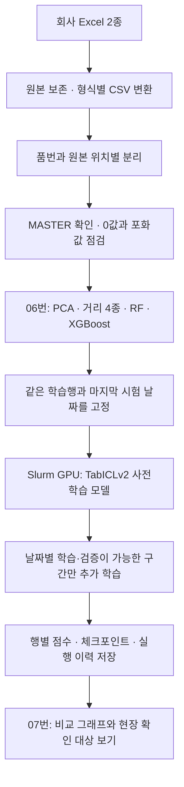

# 새 크랙·샤프트 자료와 사전학습 모델 사용하기

이번에 받은 Excel은 기존 05번의 표준 CSV와 구조가 다릅니다. 새 형식은 06번에서 분석하고, GPU 비교 결과는 07번에서 확인합니다.

## 회사 담당자가 서버에서 확인하는 순서

1. 개별 전달받은 인증 링크로 접속합니다.
2. 왼쪽 `notebooks`에서 `06_261026_크랙_샤프트_실제자료검증.ipynb`를 엽니다.
3. `Run → Run All Cells`를 누르면 준비된 실제 데이터로 분석을 다시 계산합니다.
4. 품번·위치별 수량, MASTER 확인표, PCA와 모델 비교를 순서대로 봅니다.
5. 사전학습 모델 결과는 `07_사전학습모델_GPU_비교결과.ipynb`를 열어 같은 메뉴로 표시합니다.
6. 아래쪽 ZIP 다운로드에서 보고서·그래프·행별 점수를 받습니다.

07번은 완료된 GPU 실험 결과를 확인하는 노트북입니다. 모델 학습은 아래 Slurm 절차로 따로 실행합니다. 공개 GitHub의 노트북에는 회사 데이터와 실행 결과가 없으므로, 실제 결과를 보려면 인증 서버를 이용하거나 별도 결과 폴더를 준비해야 합니다.

## 입력과 판정 기준

| 항목 | 적용 방식 |
|---|---|
| 크랙 | 필터별 측정값을 사용. 위치 3·4를 따로 계산 |
| 샤프트 | 주파수·블록별 X/Y와 측정값을 사용. 위치 1~5를 각각 계산 |
| 크랙 MASTER | 전달 지침에 따라 날짜·위치별 첫 검사 건을 기준시료로 가정. 설비 OK로 표시된 경우 확인 필요 |
| 샤프트 MASTER | 검사번호의 `NG마스터` 명시를 우선 사용 |
| 최대측정값 0 | 판정 불명으로 분석에서 제외하고 원본은 보존 |
| 100값 | 별도 측정값이 +100인 주파수 채널의 X/Y·측정값을 함께 제외한 결과 비교 |
| 32767 | 반복 상한 의심값으로 취급해 해당 채널도 제외한 보수적 비교 추가. 장비 사양 확인 필요 |
| 날짜 분리 | 마지막 날짜를 시험으로 남기고 그 이전 자료로 학습 |
| 시험일의 새 포화 | 학습 때 제외하지 못한 채널에서 새 포화값이 나오면 점수와 무관하게 보류 |

일반 NG의 진성·가성은 미확정입니다. MASTER 유사성 점수나 AUC를 실제 불량 검출 정확도로 해석하지 않습니다. 같은 MASTER의 반복 측정일 수도 있습니다.



## 새 PC에서 파일 준비하기

기본 Windows 설치는 [Windows·VS Code 가이드](Windows_VSCode_실행가이드.md)를 사용합니다. 원본 두 파일을 다음 위치에 넣고 06번을 실행하면 변환기를 호출합니다.

```text
data/raw/261026_크랙검사 건.xlsx
data/raw/261026_샤프트 열처리 검사 건.xlsx
```

파일명이 다르면 06번 첫 코드 셀의 경로를 바꿉니다. 변환 결과는 `data/processed/new_delivery`에 저장합니다. 이미 변환한 운영 서버에서는 기존 CSV를 읽습니다.

직접 변환하려면 저장소 폴더에서 실행합니다.

```powershell
.\.venv\Scripts\python.exe scripts/convert_delivery_excel.py --crack "data/raw/261026_크랙검사 건.xlsx" --shaft "data/raw/261026_샤프트 열처리 검사 건.xlsx" --output "data/processed/new_delivery"
```

이 변환기는 이번 전달 형식용입니다. 다른 열 배치의 Excel은 담당자가 구조를 먼저 확인해야 합니다.

## 연구실 담당자가 GPU에서 재실행하기

GPU는 Slurm 예약으로 할당받습니다. SSH에서는 파일 준비와 설치를 하고, 모델 실행은 `sbatch` 또는 `srun`을 사용합니다. 예약 ID와 접속 정보는 각자 전달받은 값을 사용합니다.

### 1. 독립 GPU 환경 설치

검증 환경은 Python 3.10, PyTorch 2.8.0 + CUDA 12.8, RTX PRO 5000입니다. 기본 Windows·Docker 환경과 별도 폴더에 준비합니다.

```bash
git clone https://github.com/barraki72268-sketch/Koreamovenex.git "$HOME/Koreamovenex"
bash "$HOME/Koreamovenex/gpu/setup.sh" "$HOME/movenex-gpu"
```

설치 스크립트는 CUDA 라이브러리와 공식 TabICLv2 소스를 설치하고 체크포인트 해시를 검사합니다. 처음에는 다운로드에 시간이 걸립니다.

| 항목 | 고정값 |
|---|---|
| 공식 소스 | [soda-inria/tabicl](https://github.com/soda-inria/tabicl) |
| 소스 commit | `c91f00df184a5097e584cb376f7e699e9f3444c4` |
| 체크포인트 | `tabicl-classifier-v2-20260212.ckpt` |
| 배포처 | [jingang/TabICL](https://huggingface.co/jingang/TabICL) |
| 모델 revision | `4dcd344ece2c00be9e831fdd35bed57b5ad83e19` |
| SHA-256 | `bdc7dbd5e4ff21f8f0456fcf90c6b7cdf72dbea960f2d05b19bec19f9b3d4ed0` |

### 2. 학습·시험 입력 고정

06번 실행이 끝나면 출력한 결과 폴더 이름을 확인합니다. 아래 `results/신규검증_실행시각`을 그 경로로 바꿉니다.

```powershell
.\.venv\Scripts\python.exe scripts/export_foundation_inputs.py --input-folder "data/processed/new_delivery" --analysis-folder "results/신규검증_실행시각" --output "data/processed/foundation/inputs"
```

생성한 `inputs` 폴더를 GPU 작업 폴더인 `movenex-gpu/inputs`로 옮깁니다. 여기에는 실제 회사 측정값이 들어 있으므로 인증된 연구실 서버로 전달합니다.

### 3. 예약 GPU 작업 제출

```bash
cd "$HOME/movenex-gpu"
sbatch --reservation=본인예약ID "$HOME/Koreamovenex/gpu/tabicl_job.sh" --epochs 5 --output results_fp32
```

현재 실험 설정은 다음과 같습니다.

- 사전학습 모델의 기본 전처리와 큰값 보존 전처리를 각각 비교합니다.
- 수치 안정성을 위해 최종 계산은 FP32를 사용합니다.
- 추가 학습은 이전 날짜 안에서 학습일과 검증일을 나눌 수 있고, 학습 MASTER가 2행 이상일 때만 수행합니다.
- 최대 5 epoch, 학습률 1e-5로 학습하며 열·행 인코더는 고정합니다.
- 시험 날짜는 가중치 학습과 체크포인트 선택에 사용하지 않습니다.

`squeue -u "$USER"`로 진행 상태를 보고, 완료 후 `results_fp32/COMPLETED.json`의 오류 수를 확인합니다.

### 4. 결과 묶음과 보고서 만들기

GPU 서버에서 실행합니다.

```bash
cd "$HOME/movenex-gpu"
.venv/bin/python "$HOME/Koreamovenex/scripts/pack_foundation_results.py" --work-dir "$PWD"
```

생성한 `foundation_results.tar.gz`를 분석 PC로 내려받습니다. 분석 PC의 기본 Python 3.12 환경에서 아래처럼 보고서를 만듭니다.

```powershell
.\.venv\Scripts\python.exe scripts/build_foundation_report.py --bundle "받은파일/foundation_results.tar.gz" --output "notebooks/20261026_사전학습모델결과"
```

보고서 폴더가 준비되면 07번을 실행합니다. 현재 운영 서버에는 이 과정까지 완료되어 있습니다.

## 어디에 무엇이 저장되나요?

| 위치·파일 | 내용 |
|---|---|
| 06번 결과 폴더 | 원본 수량, MASTER 확인표, PCA, 거리·RF·XGBoost 점수와 모델 |
| GPU `results_fp32/model_summary.csv` | 품번·위치·모델별 시험 결과 |
| GPU `*_predictions.csv.gz` | 행별 점수와 보류 사유 |
| GPU `*_finetuned/inference.ckpt` | 추가 학습한 추론용 가중치 |
| GPU `*_finetuned/adaptation_audit.json` | gradient step과 원본 가중치 대비 변경량 |
| `checkpoint_manifest.json` | 체크포인트 경로와 해시 |
| 보고서 폴더의 HTML·PNG·CSV | 07번에서 읽는 표·그래프와 현장 확인 대상 |

큰 체크포인트는 GPU 서버에 보관하고 보고서 묶음에는 경로·해시를 기록합니다. Git에는 소스와 안내만 올리며, 회사 파일·학습 입력·모델 가중치·실행 결과는 별도로 관리합니다.
