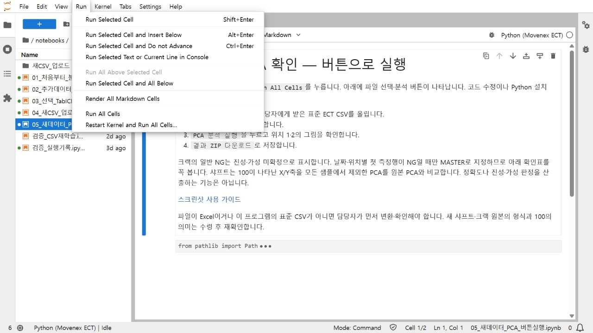
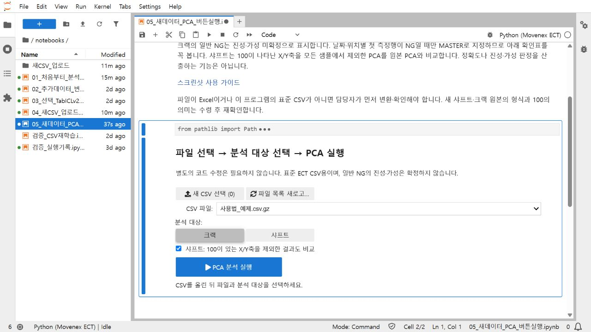
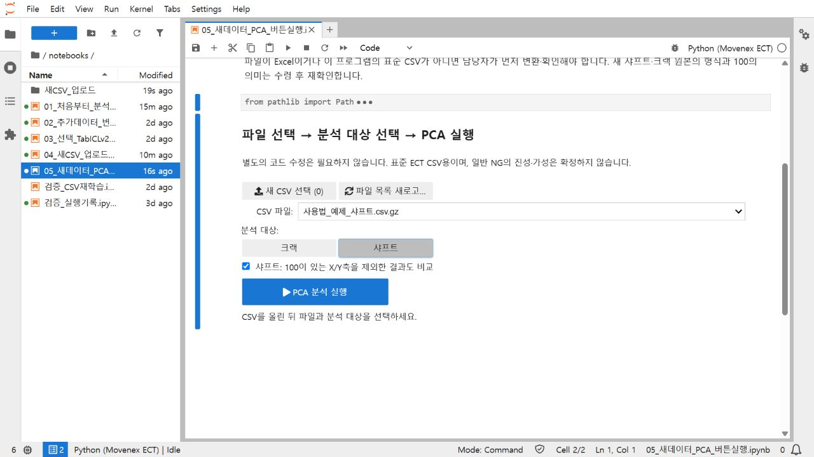
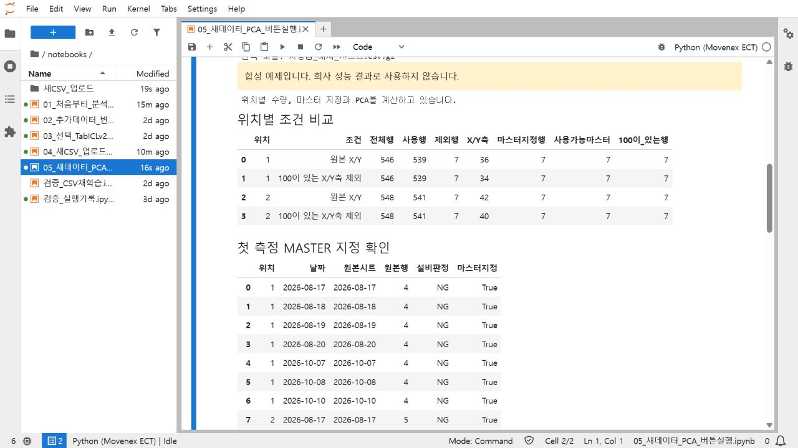
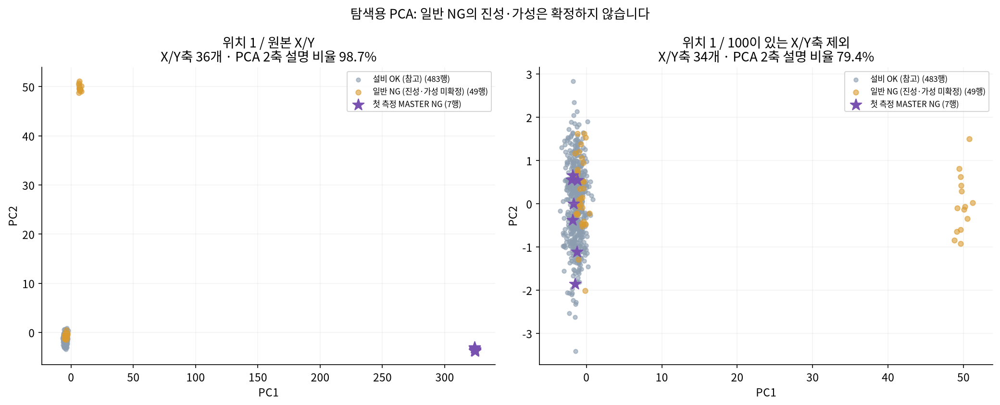
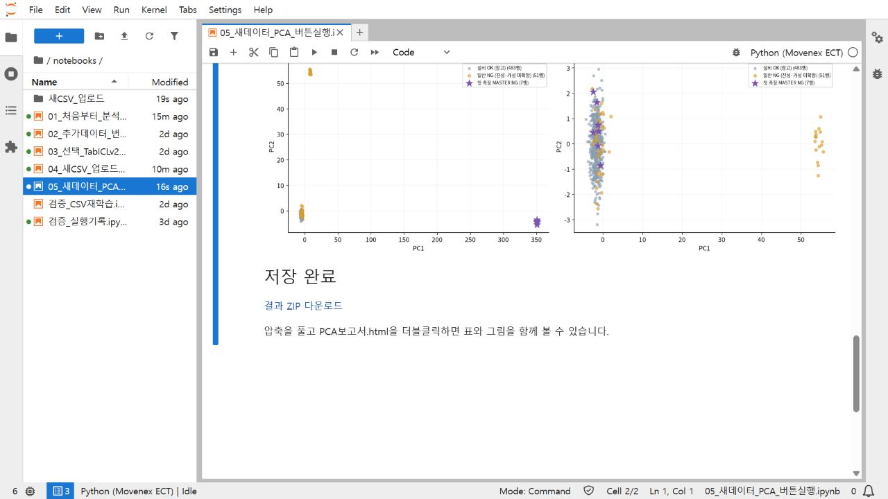

# 서버에서 새 CSV로 PCA 확인하기

설치 없이 브라우저로 실행하는 방법입니다. 코드를 고칠 필요 없이 파일 선택과 버튼으로 진행합니다. 아래 화면은 합성 예제로 촬영했으며 실제 회사 원본 데이터는 공개하지 않았습니다.

## 먼저 확인할 것

- 담당자가 개별 전달한 인증 링크로 접속합니다. 로그인 화면이 나오면 함께 전달받은 토큰을 맨 위 `Password or token`에 입력합니다. 하단의 비밀번호 설정은 사용하지 않습니다.
- PC의 Chrome 또는 Edge를 권장합니다. 휴대폰에서는 화면이 좁아 PC에서 진행하는 편이 좋습니다.
- 사용할 파일은 이 프로그램의 ECT 표준 `.csv` 또는 `.csv.gz`입니다. `.gz`는 압축을 풀지 않습니다.
- Excel 원본, 열 이름이 다른 CSV, 품번이나 주파수 구성이 섞인 파일은 담당자가 먼저 변환·확인해야 합니다. 아무 CSV나 자동으로 해석하지 않습니다.

인증 링크와 회사 파일을 GitHub나 공용 게시판에 올리지 않습니다. 아래 가이드에는 로그인 토큰을 넣지 않았습니다.

## 1. 05번 노트북을 엽니다

왼쪽 파일 목록에서 `notebooks`를 열고 `05_새데이터_PCA_버튼실행.ipynb`를 더블클릭합니다. 기존 01번 노트북이 열려 있어도 파일 목록에서 05번을 추가로 열면 됩니다.

처음 한 번만 위쪽 메뉴의 `Run > Run All Cells`를 누릅니다. 아래에 파일 선택과 PCA 실행 버튼이 나타납니다. 이 과정은 입력 화면을 준비하는 단계입니다. 아직 새 파일을 분석하지 않습니다.

오른쪽 위에 실행 환경 선택이 나오면 `Python (Movenex ECT)`를 고릅니다. `Error displaying widget`처럼 버튼이 표시되지 않으면 새로 고침한 뒤 05번에서 다시 전체 실행하고, 계속되면 담당자에게 화면을 전달합니다.

## 2. 새 CSV를 선택합니다

`새 CSV 선택`을 누르고 PC에 받은 파일을 고릅니다. 직접 파일 경로를 입력할 필요는 없습니다.

`업로드 완료: 파일명`이 표시되고 `CSV 파일` 목록에 방금 올린 파일이 선택됐는지 확인합니다. 파일을 선택한 직후에는 전송이 끝날 때까지 잠시 기다립니다. 같은 이름을 다시 올리면 기존 파일을 덮어쓰지 않고 시각을 붙인 새 이름으로 저장합니다.

이미 올린 파일을 다시 분석하려면 `CSV 파일` 목록에서 선택합니다. 목록이 갱신되지 않으면 `파일 목록 새로고침`을 누릅니다.

## 3. 크랙 또는 샤프트를 선택합니다

이번에 받은 자료에 맞게 `크랙` 또는 `샤프트`를 누릅니다.

| 자료 | 화면에서 확인할 내용 |
|---|---|
| 크랙 | 첫 측정 MASTER, 설비 OK, 일반 NG가 PCA 그림에서 어떤 위치에 있는지 |
| 샤프트 | 원본 PCA와 `100이 있는 X/Y축 제외` PCA를 나란히 비교 |

샤프트는 `100이 있는 X/Y축을 제외한 결과도 비교`를 체크한 상태로 실행합니다.

현재 100값 처리는 `+100`이 한 번이라도 나타난 X/Y축을 모든 샘플에서 빼고 PCA를 다시 계산하는 방식입니다. 마스터 행 전체를 일괄 삭제하거나, 100을 0으로 바꾸는 방식은 아닙니다. 최대측정값 열만 100인 경우나 -100은 이 축 제외 규칙에 포함하지 않습니다. 정확한 포화값 의미와 적용 범위는 새 원본 수령 후 현장 설명과 재확인합니다.

## 4. PCA 분석 실행을 누릅니다

`PCA 분석 실행`을 한 번 누르고 기다립니다. 실행 중에는 버튼이 비활성화됩니다. 업로드한 파일만 분석하며, 01번의 기존 회사 CSV를 자동으로 합치거나 수정하지 않습니다. 별도의 학습 날짜를 입력할 필요도 없습니다.

위치 1과 위치 2는 각각 계산합니다. 서로 다른 품번의 자료도 한 파일에 합치지 않습니다.

## 5. 마스터 확인표를 먼저 봅니다

이번 지침은 그날의 첫 검사 데이터가 NG MASTER라는 것입니다. 프로그램은 위치·날짜별로 원본 시트·행 순서의 첫 측정행을 찾아, 설비 판정이 NG일 때 마스터로 표시합니다. 이는 진성·가성 최종 판정을 자동으로 만드는 규칙이 아닙니다.

`첫 측정 MASTER 지정 확인` 표에서 날짜, 위치, 원본 시트·행 번호와 마스터 지정 여부를 확인합니다.

첫 행이 OK이거나 오류·0·노랑으로 제외되어 사용 가능한 마스터가 없다면 안내가 나옵니다. 이때 임의로 다른 NG를 마스터로 정하지 말고, 실제 최초 검사 건과 데이터 순서를 담당자에게 확인합니다. 새 원본의 시트 구성이나 검사 건 연결 방식이 다르면 먼저 정리해야 합니다.

## 6. PCA 그림을 비교합니다

| 표시 | 의미 |
|---|---|
| 보라색 별 | 첫 측정 MASTER NG |
| 회색 점 | 설비 OK 참고 데이터 |
| 주황색 점 | 진성·가성이 확인되지 않은 일반 NG |

크랙은 일반 NG가 마스터 주변에 모이는지, OK와 어떤 관계로 나타나는지 살펴봅니다. 마스터와 가깝다는 이유만으로 진성, 멀다는 이유만으로 가성으로 확정하지 않습니다.

샤프트는 100값이 있는 X/Y축을 제외하기 전·후를 비교합니다. `X/Y축` 수, `사용행`, `사용가능마스터`가 얼마나 남았는지 표와 함께 봅니다. 남은 축이 2개보다 적거나 유효행이 3개보다 적으면 PCA를 계산하지 않고 이유를 표시합니다.

아래는 사용법 확인을 위한 합성 예제의 위치 1 결과입니다. 실제 새 샤프트 데이터의 분석 결과가 아닙니다. 위치 2도 별도 그림으로 표시됩니다.

PCA는 여러 측정값을 두 축으로 줄인 탐색 그림입니다. 현재 파일 전체로 PCA를 계산하며, 100값 제외 전·후 그림은 축이 새로 계산되므로 좌표나 점의 방향 자체를 직접 비교하지 않습니다. 그림의 분리가 실제 진성·가성 검출 성능이나 물리적 불량 원인을 입증하지는 않습니다. 점이 많으면 각 표시 구분마다 최대 1,500행을 균등하게 표시하고, 좌표 CSV에는 전체 유효행을 저장합니다.

## 7. 결과 ZIP을 내려받습니다

아래쪽에 `저장 완료`가 나오면 `결과 ZIP 다운로드`를 누릅니다. PC의 다운로드 폴더에 저장됩니다. 브라우저가 다운로드 허용을 묻는 경우 파일명과 접속 주소를 확인합니다.

받은 ZIP을 오른쪽 클릭해 `모두 압축 풀기`를 선택하고, 안의 `PCA보고서.html`을 더블클릭합니다. 인터넷 접속 없이 표와 그림을 함께 볼 수 있습니다.

| ZIP 안의 파일 | 내용 |
|---|---|
| `PCA보고서.html` | 조건별 수량, 마스터 표, 위치별 그림과 해석 범위 |
| `위치1_PCA.png`, `위치2_PCA.png` | 보고·공유용 그림. 해당 위치가 있을 때 생성 |
| `01_위치별_조건비교.csv` | 사용행·제외행·남은 축·사용 가능한 마스터 수 |
| `02_마스터지정_확인.csv` | 최초 마스터로 지정한 원본 행 |
| `03_PCA좌표와_참고거리.csv` | 전체 유효행의 PCA 좌표와 마스터·OK에 대한 참고 거리 |
| `04_100값으로_제외한축.csv` | 100값이 나타난 위치·블록·주파수·축과 행 수 |
| `05_제외행과_사유.csv` | 오류·0·노랑·결측 등 제외 현황 |
| `실행설정.json` | 입력 파일 해시, 분석 대상, 적용 규칙과 한계 |

## 다른 파일을 다시 분석할 때

같은 화면에서 다른 CSV를 선택하고 분석 대상을 확인한 뒤 `PCA 분석 실행`을 다시 누르면 됩니다. 결과는 실행 시각별 새 폴더로 저장됩니다. 창을 새로 열거나 커널이 종료되어 버튼이 반응하지 않으면 05번 노트북에서 처음 한 번 `Run > Run All Cells`를 눌러 화면을 준비합니다.

여러 사람이 한 서버를 쓰는 구성이라 같은 노트북을 동시에 수정·저장하면 설정이 섞일 수 있습니다. 이번 버튼 화면은 각자 접속한 커널에서 파일을 선택해 실행하되, 공용 파일을 덮어쓰거나 다른 사람의 커널을 종료하지 않습니다. 사용자별 완전한 분리 계정이 제공되는 JupyterHub 구성은 별도 운영 항목입니다.

## 자주 막히는 부분

| 화면 또는 상황 | 확인 방법 |
|---|---|
| 로그인 화면 | 전달받은 전체 인증 링크 또는 토큰 사용. 하단 새 비밀번호 설정은 하지 않음 |
| 새 CSV 선택 버튼이 없음 | 05번을 열고 처음 한 번 `Run All Cells` 실행 |
| 업로드는 했는데 다른 파일이 분석됨 | `CSV 파일`에 선택된 이름과 결과의 `선택 파일` 문구 확인 |
| 필수 컬럼 누락 | 표준 ECT CSV가 아닌 경우. 담당자에게 변환 요청 |
| 파일명이 같은데 새 이름이 붙음 | 기존 자료 보호를 위한 동작. 새 이름이 선택됐는지 확인 |
| 첫 측정행이 OK라는 안내 | 최초 검사 건·원본 행 순서를 확인. 다른 NG를 임의 마스터로 지정하지 않음 |
| 마스터가 0개 남음 | 오류·0·노랑 등 제외 현황 확인. 새 정상 마스터 데이터 필요 여부 문의 |
| 100값 제외 후 PCA 불가 | 남은 X/Y축과 유효행 수 부족. 원본·제외 목록과 함께 담당자에게 전달 |
| 결과에 진성·가성 정확도가 없음 | 해당 라벨이 확인되지 않은 탐색용 PCA이므로 정상 동작 |
| 새 자료가 Excel임 | 원본 구조 확인 후 CSV 변환 필요. 02번 변환기도 기존 템플릿용이므로 형식이 다르면 수정 필요 |

## 기존 라벨 분석이 필요한 경우

진성·가성 라벨이 연결된 기존 C10A의 거리 기준·RF·XGBoost 재현은 01번, 추가 파일 변환·병합·재학습은 02번을 사용합니다. 04번은 표준 CSV 파일명과 날짜를 지정해 기존 모델 분석을 하는 선택 실행용입니다. 이번 미확정 크랙·샤프트 탐색은 05번부터 시작합니다.

공식 사용법: [JupyterLab 파일 업로드·다운로드](https://jupyterlab.readthedocs.io/en/stable/user/files.html), [Jupyter 위젯 설치](https://ipywidgets.readthedocs.io/en/stable/user_install.html).
