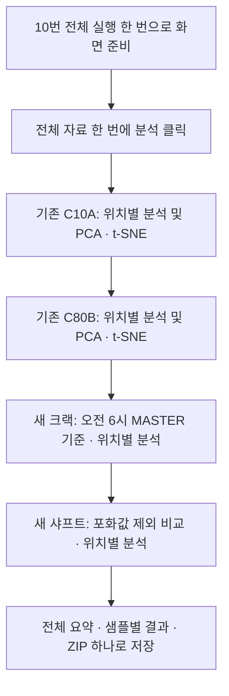
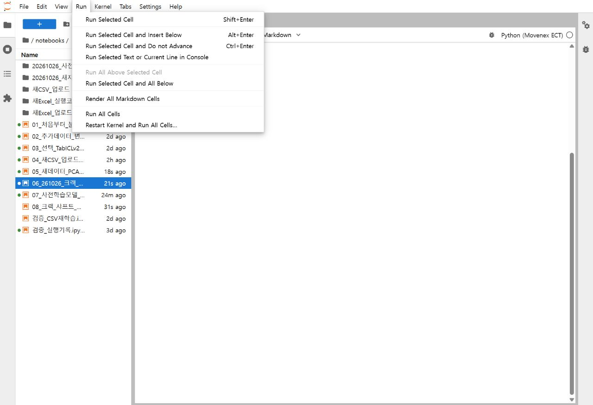
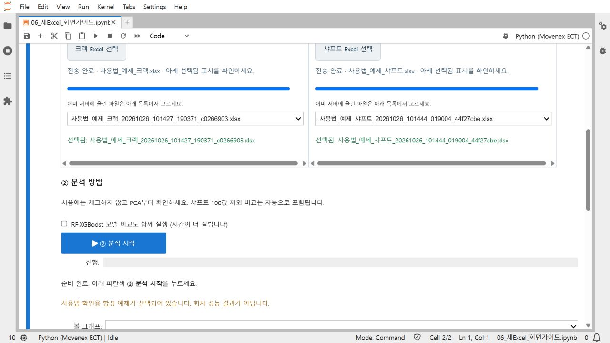

> 이전 일괄 탐색 화면의 안내입니다. 학습 후 새 샘플 반복 검사는 [09번 사용 설명서](통합테스트_가이드.md)를 이용하세요.

# 기존 자료와 새 자료를 한 화면에서 확인하기

## 1. 10번을 엽니다

`10_연구용_기존자료_일괄비교.ipynb`를 열고 `Run → Run All Cells`를 한 번 누릅니다. 맨 위에 전체 실행 버튼이 나타납니다.

### 가장 쉬운 방법: 버튼 한 번으로 전부 실행

1. 맨 위에 등록된 자료 4개를 확인합니다. 서버에는 실제 기존 C10A·C80B와 새 크랙·샤프트가 등록되어 있습니다.
2. 초록색 `전체 자료 한 번에 분석`을 한 번 누릅니다. 파일 선택이나 체크박스 조작은 필요 없습니다.
3. `1/4 기존 C10A → 2/4 기존 C80B → 3/4 새 크랙 → 4/4 새 샤프트` 순서로 진행됩니다. PCA·RF·XGBoost 다음에 위치별 t-SNE를 계산하므로 수 분이 걸릴 수 있습니다.
4. 위치별 계산이 끝나는 대로 아래에 `왼쪽 PCA / 오른쪽 t-SNE`가 이어서 나타납니다. 스크롤을 내려 자료별로 확인합니다.
5. 마지막 `전체 결과 ZIP 다운로드`를 누릅니다. 압축을 풀고 `전체자료_보고서.html`을 열면 같은 순서로 볼 수 있습니다.

품번·위치는 계속 따로 계산합니다. 샤프트의 자동 PCA·t-SNE 나란히 보기는 `100·32767 채널 전체 제외` 조건으로 통일했습니다. 원본·100 제외·X/Y만 사용 등 다른 PCA 비교도 각 자료 보고서에 함께 저장됩니다. 계산할 입력이 부족하면 해당 조건의 사유를 표시합니다.

맨 아래 `전체 샘플의 모델 결과·MASTER 거리 확인`을 펼치면 네 자료를 한 목록에서 검색할 수 있습니다. 개별 파일을 다시 분석하거나 새 파일을 업로드하려면 `필요할 때만: 파일 하나씩 실행 / 새 파일 업로드`를 펼칩니다. 아래의 탭 안내는 이 개별 실행 방식입니다.

### 별도 서버에 설치하는 담당자

[자료 목록 예제](../data/config/전체실행_자료.example.json)를 `data/private/전체실행_자료.json`으로 복사해 실제 파일 4개의 경로를 적습니다. CSV 폴더를 읽기 전용으로 연결했다면 `notebooks/전체실행_자료.json`에 둘 수 있습니다. 회사 데이터나 이 실제 경로 설정 파일을 공개 GitHub에 올리지 않습니다. 자료가 없으면 전체 실행 버튼이 비활성화되며 합성 데이터로 자동 대체하지 않습니다.

### 크랙 TabICLv2 그림 읽기

현재 서버에 등록된 크랙 원본은 GPU 실험 결과와 연결되어 있습니다. 크랙 부분에 모델 점수 요약이 먼저 나오고, 각 품번·위치에서 왼쪽 내부 특징 PCA / 오른쪽 내부 특징 t-SNE를 확인합니다. `원본과 같은 샘플로 비교`를 펼치면 원본 측정값과의 대조 그림도 볼 수 있습니다. 기본 TabICLv2 설정을 비교 가능한 5개 구간에 동일하게 사용하며, 큰값 보존 설정의 그림·점수도 ZIP에 포함합니다.

이는 저장된 GPU 작업 15186의 결과입니다. 전체 실행 버튼을 누를 때마다 새 GPU 학습을 하는 방식은 아닙니다. 원본 파일 SHA256과 오전 6시 검사일 기준이 일치할 때만 연결합니다. 새 크랙 파일을 올리거나 검사일 경계를 바꾸면 이전 결과를 사용하지 않고 원본 그림으로 안내합니다. 샘플별 표에는 `TabICLv2점수`와 `TabICLv2결과`가 추가되며, GPU 시험일 밖의 행은 미계산으로 남습니다.

C12 위치 3·4, C80A 위치 3은 이전 날짜의 유효 NG MASTER가 부족해 TabICLv2 비교를 하지 못했습니다. 해당 구간은 사유와 원본 참고 그림을 표시합니다. C11A 위치 3의 시험일 MASTER 후보는 설비 OK와 충돌하므로 확정 MASTER 평가에 넣지 않습니다. 그림에서 잘 분리된 구간만 골라 표시하지 않습니다.

MASTER 4건과 설비 OK 6,201건의 비교이며 일반 NG 28건의 진성·가성 정답은 없습니다. `MASTER 유사 높음`은 진성불량 확정 판정이나 실제 불량 확률을 뜻하지 않습니다. 샘플 조회 아래의 `다른 PCA 축·확대·t-SNE`는 기존 원본 입력의 참고 그림으로, 위쪽 내부 특징 그림과 구분합니다.

다른 서버에는 실제 GPU 결과 폴더 `notebooks/크랙_TabICLv2_결과/`를 별도로 전달해야 합니다. 공개 GitHub에는 회사 결과를 넣지 않습니다. 이 폴더가 없거나 파일 해시가 다르면 원본 보기를 사용합니다. GPU 추출 코드는 `scripts/run_tabicl_representation.py`이며, Slurm 할당 내에서 사용합니다.

위 사진은 기존 06번에서 촬영한 공통 메뉴 안내입니다. 이번에는 왼쪽 파일 목록에서 10번을 열고 같은 메뉴를 누릅니다.

| 탭 | 선택할 파일 | 실행 방식 |
|---|---|---|
| 새 크랙·샤프트 Excel | 이번에 받은 `.xlsx` | 기존 자동 변환과 위치별 PCA. RF·XGBoost는 체크해서 추가 |
| 기존 자료 CSV | 기존 C10A·C80B 표준 `.csv.gz` | 기존 거리 보완 기준·RF·XGBoost·기업 라벨을 그대로 재현 |

서버에 이미 올라간 자료는 버튼 아래 파일 목록에서 선택합니다. `Excel 선택` 또는 `기존 CSV 선택`은 내 PC의 새 파일을 업로드할 때 사용합니다. 같은 화면에서 파일을 바꿔 다시 실행할 수 있습니다.

새 Excel 탭의 파일 선택 방법은 위 사진과 같습니다. 10번에는 분석 버튼 위에 `크랙 검사일 시작` 항목이 추가되어 있으며 기본값 6을 그대로 두면 됩니다. [파일 선택부터 결과 저장까지 사진으로 보기](새Excel_화면가이드.md)도 함께 참고하세요.

C80B를 선택하면 학습 종료일 2026-10-06·기준 종료일 2026-10-07, C10A는 2026-08-20·2026-10-07을 기본으로 넣습니다. 새로운 기간의 기존 형식 CSV라면 날짜를 확인한 뒤 실행합니다. 기존 형식 CSV는 원본 Excel과 기업 회신을 연결해 만든 표준 자료입니다. 새 형식 Excel을 기존 CSV 탭에 넣지 않습니다.

한 화면에서 실행하지만 모든 품번을 하나의 가중치로 합쳐 학습하는 것은 아닙니다. 위치·품번별 모델을 분리하고, 크랙 필터값과 샤프트 X/Y처럼 다른 입력 구조는 각 형식에 맞게 처리합니다.

## 2. 크랙의 검사일 시작을 확인합니다

기본값은 오전 6시입니다. 화면에서 0~23시 사이로 바꿀 수 있습니다.

| 원본 측정 시각 | 검사일 | MASTER 후보 |
|---|---|---|
| 10월 21일 01:30 | 10월 20일 | 전일 말미 데이터. 이 행만 있다고 MASTER로 지정하지 않음 |
| 10월 21일 06:00 이후 첫 행 | 10월 21일 | 같은 품번·위치에서 당일 첫 측정인 경우 후보 |
| 10월 22일 01:30 | 10월 21일 | 전일 말미 데이터 |

원본 날짜·시간은 바꾸지 않습니다. 분석용 검사일을 별도로 기록합니다. 일자별 원본 시트 순서보다 실제 측정 시각을 우선합니다.

첫 행의 설비 판정이 OK이면 `MASTER판정충돌`로 표시하고 지도학습 양성과 MASTER 거리 기준에서 제외합니다. 최대측정값 0·결측은 분석 제외 사유를 남깁니다. 확정 진성 라벨을 새로 만들지 않습니다. `12_크랙_MASTER변경.csv`에서 기존 기준과 바뀐 원본 행을 확인할 수 있습니다.

샤프트는 기존대로 검사번호의 `NG마스터` 명시를 사용합니다. 기존 C10A·C80B CSV의 기업 MASTER·진성·가성 라벨도 바꾸지 않습니다.

## 3. 각 샘플의 결과와 거리를 봅니다

분석이 완료되면 아래 `샘플별 결과와 거리 확인`으로 내려갑니다.

1. `결과 선택`에서 품번·위치·입력 조건을 고릅니다.
2. `볼 샘플`에서 일반 NG, MASTER, 설비 OK, 제외행 또는 전체를 고릅니다.
3. 검색란에 날짜, 검사번호, 원본 행 번호 또는 샘플ID를 입력합니다.
4. 표에서 50행씩 확인하고 `샘플 선택` 목록에서 한 행을 고릅니다.
5. `선택 샘플 상세`를 펼쳐 점수·거리·학습 포함 여부를 확인합니다.

| 항목 | 읽는 방법 |
|---|---|
| 설비판정 | 검사기에서 기록한 OK/NG |
| 현장판정 | 기존 기업 회신의 진성·가성. 새 일반 NG는 미확정 |
| MASTER여부 / MASTER판정충돌 | 기준 지침에 따른 후보와 설비 판정 충돌 여부 |
| NG_MASTER거리 | 유효 MASTER에 대한 최근접 참고 거리. 작을수록 비슷한 패턴 |
| OK거리 | 참고 OK에 대한 최근접 거리. 작을수록 비슷한 패턴 |
| 거리참고 | 어느 쪽 기준에 더 가까운지 보여주는 탐색 문구. 최종 진성·가성 판정 아님 |
| RF점수·RF결과 / XGBoost점수·결과 | 모델 비교를 실행했을 때 표시. 새 자료는 MASTER 유사성 점수 |
| 기존거리판정 | 기존 자료에 적용한 거리 보완 기준의 결과 |
| 기존MASTER거리비율 / 기존OK거리비율 | 기존 거리 기준 `robust_l2`의 임계값 대비 비율. 다른 기법의 결과는 기존 상세 CSV에 보존 |
| 학습포함·구간 | 해당 행이 학습에 포함됐는지, 시험 구간인지 |
| 분석가능·제외사유 | 최대값 0, 노랑, 결측·측정 오류 등의 제외 정보 |

자기 자신과의 거리는 계산에서 제외합니다. MASTER가 한 행뿐이면 그 MASTER 자신의 거리는 비어 있을 수 있습니다. `미계산`은 가성 판정이 아닙니다. 모델 비교를 끈 경우, 학습일 OK 등 모델 질의 대상이 아닌 행, 학습 기준 부족 등에서 표시됩니다.

새 자료의 참고 거리는 전체 파일의 유효 OK로 스케일을 정한 탐색 거리입니다. 독립 시험 지표가 아닙니다. 기존 자료의 실제 판정은 이전 날짜로 정한 보완 기준을 그대로 사용하고, 참고 거리와 별도로 표시합니다.

## 4. 겹치는 그림을 다른 방향으로 확인합니다

`다른 PCA 축 · 확대 보기`를 누르면 네 그림을 나란히 봅니다.

- 전체 PC1–PC2
- OK 밀집 구간 확대. 화면 밖인 점의 수를 함께 표시
- PC1–PC3
- PC2–PC3

멀리 떨어진 NG 때문에 중심부가 눌려 보이는 문제를 확대 그림으로 확인합니다. 확대 밖의 점을 삭제하지 않으며, 전체 범위를 함께 제공합니다.

`t-SNE 비교`는 별도로 누를 때만 실행합니다. 같은 입력 측정값으로 최대 OK 1,000행·그 외 유효 측정 1,000행을 균등 추출하고 seed 42로 계산합니다. 표시 수량과 전체 수량을 제목에 적고 좌표 CSV를 저장합니다. 판정 라벨을 이용해 분리를 강제로 만드는 방법이 아닙니다.

그림에서 더 떨어져 보이는 것이 실제 진성·가성 분류 성능 향상을 뜻하지 않습니다. 일반 NG의 최종 정답이 없고, MASTER와 설비 OK가 충돌하는 경우도 있으므로 표의 원본 행과 현장 판정을 함께 확인합니다.

## 5. 결과를 저장합니다

`결과 ZIP 다운로드`를 누릅니다. 새 그림을 계산한 뒤에는 `추가 그림 포함 결과 ZIP 다운로드`로 갱신됩니다.

- `samples/*.csv.gz`: 제외행을 포함한 조건별 전체 샘플 결과
- `샘플결과_목록.json`: 파일 목록, 검사일 기준과 거리 해석 범위
- `12_크랙_MASTER변경.csv`: 크랙 기준 변경 행
- `*_PCA확대와다른축.png`: 확대·다른 PCA 축 비교
- `*_tSNE.png`, `*_tSNE.csv`: 선택 실행한 t-SNE 그림과 실제 표시 좌표
- 기존 판정 상세 CSV·학습 모델·보고서는 기존 파일명으로 함께 보존

실제 회사 데이터와 결과는 인증 서버에 보관하며 공개 GitHub에는 올리지 않습니다. 01~08번과 이전 GPU 비교 결과는 그대로 보존합니다. 07번은 예전 기준으로 실행한 GPU 결과이며, 이번 6시 기준 재분석 결과와 혼용하지 않습니다.
