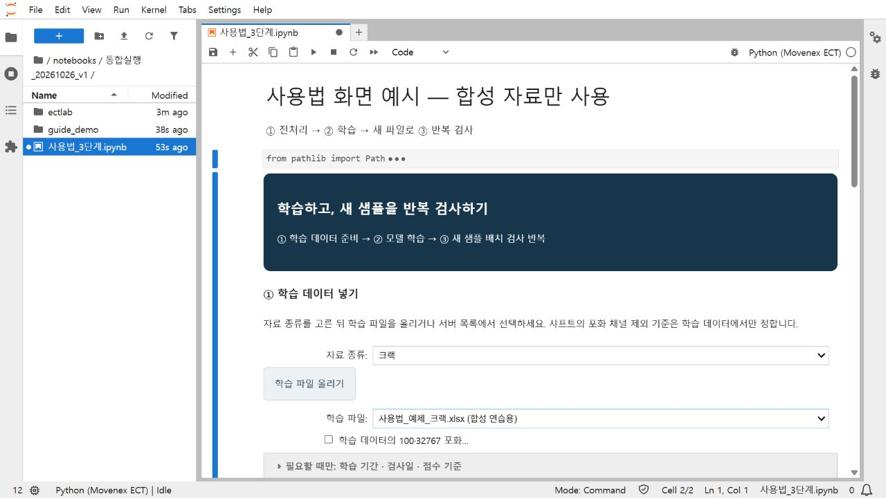

# 회사 PC에서 설치하고 실행하기

연구실 서버나 NAS에 연결하지 않고 회사 PC에서 기존 09번 노트북을 실행합니다. 데이터와 학습 모델·결과는 회사 PC에 저장됩니다.

## 준비

- Windows 10/11의 x64 PC와 인터넷 연결이 필요합니다.
- Python·VS Code·패키지 설치가 허용된 PC에서 실행하세요. 회사 보안 정책으로 설치가 막히면 전산 담당자의 확인이 필요합니다.
- 실제 데이터 포함 ZIP은 담당자에게 비공개로 받습니다. GitHub의 ZIP에는 합성 연습 자료만 있습니다.

## 처음 한 번 설치

1. ZIP을 원하는 폴더에 완전히 압축 해제합니다. 한글·공백이 들어 있거나 폴더 이름을 바꿔도 됩니다. ZIP 안에서 바로 실행하지 마세요.
2. `01_설치.cmd`를 더블클릭합니다.
3. VS Code도 설치할지 물으면 Enter를 누릅니다. 브라우저에서만 실행하려면 `n`을 입력합니다.
4. TabICLv2도 설치할지 물으면, 이 모델이 필요한 경우 `y`를 입력합니다. Enter를 누르면 기본 RF·XGBoost만 설치합니다. 추가 설치에는 공개 모델 파일과 CPU용 PyTorch 다운로드가 필요합니다.
5. `설치 완료`가 나올 때까지 기다립니다. 처음에는 인터넷 속도에 따라 시간이 걸립니다.

설치 파일은 Python 3.12 64비트를 확인하고, 없으면 Python.org에서 공식 설치 파일을 받습니다. Jupyter와 분석 패키지는 사용자 계정의 `.mvx` 폴더 아래 짧은 경로에 자동으로 설치합니다. 압축을 푼 폴더의 이름이나 길이와 실행 환경을 분리해 Windows 패키지 설치의 경로 제한을 피합니다. VS Code를 선택하면 Microsoft의 사용자용 설치 파일과 Python·Jupyter 확장도 준비합니다. 받은 Python·VS Code 설치 파일은 디지털 서명이 유효하고 발행자가 맞는지 확인한 후 실행합니다.

다른 Python 환경이나 NAS 설정은 변경하지 않습니다. 일반적인 사용자 설치를 사용하며 회사 정책에 따라 추가 권한이 필요할 수 있습니다. `.cmd`가 호출하는 PowerShell 실행 설정은 해당 설치 프로세스에만 적용하며 시스템 실행 정책을 바꾸지 않습니다.

XGBoost의 DLL을 불러오지 못하면 Microsoft Visual C++ 실행 구성요소도 공식 설치 파일로 준비합니다. 이 구성요소는 Windows 관리자 승인이나 재시작이 필요할 수 있습니다. 설치 후에도 모듈 검사를 통과해야 설치 완료로 표시합니다.

## 분석 시작

1. `02_분석실행.cmd`를 더블클릭합니다. 실행 창은 열어 두세요.
2. 브라우저에 09번 노트북이 열리면 위쪽 `Run → Run All Cells`를 한 번 누릅니다.
3. 자료 종류와 학습 파일을 고르고 `① 데이터 읽기 · 전처리`를 누릅니다.
4. `② 모델 학습`을 누릅니다.
5. 새 검사 파일을 올리고 `③ 새 샘플 배치 검사`를 누릅니다. 다음 파일도 ③번만 반복합니다.

③ 처리 중에는 파일 선택창과 버튼이 회색으로 잠깁니다. 파일 선택창 위의 진행 문구에서 Excel 읽기, 샘플 판정, CSV·PCA·ZIP 저장 단계를 확인하세요. 완료되거나 오류가 표시되면 파일 선택이 다시 활성화됩니다. 큰 샤프트 Excel의 첫 변환은 수분이 걸릴 수 있으며, 같은 내용의 파일은 이름을 바꿔 다시 올려도 검증된 변환 결과를 재사용합니다.

위 사진은 합성 자료로 찍은 조작 예시입니다. 실제 자료 포함 패키지에서는 서버 파일 대신 PC의 실제 파일을 목록에서 선택합니다. 화면의 ‘서버 목록’ 표현도 실행 중인 회사 PC의 목록을 뜻합니다.

상세 조작은 [스크린샷 사용 설명서](통합테스트_가이드.md)를 참고하세요. 이 PC에서만 열리는 `127.0.0.1` 주소를 사용하므로 연구실 서버가 꺼져 있어도 실행됩니다. 다른 사람에게 이 주소를 전달해도 원격 접속 주소로 사용할 수는 없습니다.

## VS Code에서 실행할 때

VS Code에서 프로그램 폴더와 `notebooks/09_통합테스트_샘플별결과.ipynb`를 엽니다. 설치 과정에서 Python 경로를 자동으로 연결합니다. 커널 선택을 묻는다면 `Python (Movenex ECT)` 또는 설치 로그에 표시된 실행 환경을 선택하고 전체 실행합니다. 브라우저로 실행할 때는 이 과정이 필요 없습니다.

## 새 데이터 파일을 추가할 때

1. 02번으로 연 분석 화면의 ①에서 자료 종류를 고릅니다.
2. `분석할 Excel·CSV 선택`을 눌러 파일을 고릅니다. Windows 기본 파일 선택 창이 열립니다.
3. 창이 보이지 않으면 파일 탐색기의 전체 경로를 복사해 버튼 아래 칸에 붙여넣고 `위 경로의 파일 추가`를 누릅니다. 따옴표가 붙은 경로도 사용할 수 있습니다.
4. 추가 완료 표시와 학습 파일 선택을 확인한 뒤 ① 전처리 → ② 학습 → ③ 검사 순서로 진행합니다. 검사 파일은 비어 있으면 학습 파일과 같은 파일로 준비됩니다.
5. 이미 프로그램 폴더에 파일을 넣었다면 `파일 목록 새로고침`으로 갱신할 수 있습니다.

별도 03번 데이터 추가 CMD는 새 회사용 ZIP에서 제외했습니다. 이미 학습한 모델로 새 샘플만 검사하려면 화면의 `③ 새 검사 파일 올리기`를 사용하세요. 학습 상태를 유지하고 ③번만 반복할 수 있습니다. 원본은 보존하고 복사본으로 처리합니다.

## 그래프와 NG 판정 결과 읽기

- MASTER는 보라색 별, 최대검출값 0은 초록색 원, 검사기 합격은 파란색 원으로 표시합니다.
- 일반 NG 중 진성불량 의심은 빨강, 가성불량 후보는 주황으로 표시합니다. 보류·입력 확인은 회색 계열로 남깁니다.
- 최대값 0은 판정이 확정되지 않은 기준자료입니다. 측정 입력이 유효하면 학습한 PCA에 좌표만 표시하며, 학습·AI 판정의 정답으로 사용하지 않습니다.
- 학습 PCA의 일반 NG는 아직 AI 판정을 하지 않아 회색입니다. ③ 검사 실행 후의 그래프와 NG 표에서 AI 추정을 확인합니다.

요약표에는 라인·품번·위치별 MASTER, 가성 추정, 진성 추정, 총 NG, PCA 설명비율을 표시합니다. 보류·최대값0·입력 오류도 별도 열에 남겨 합계가 원본 설비 NG 행 수와 일치하는지 검증합니다. 총 NG는 MASTER와 판정 불가 행을 포함합니다.

③의 라인·품번·위치와 검사일자를 고르면 그래프, 요약과 상세 표에 같은 조건이 적용됩니다. 처음에는 선택한 구간의 최신 검사일이 열리며, 필요하면 전체 일자로 바꿀 수 있습니다. 상세 현황은 기본적으로 원본 NG를 보여 줍니다. 검사일자·시간·검사수량·최대검출값·MAX FRQ·Part_No·원본 시트/행과 AI 유사점수를 확인합니다. 진성 의심은 붉은 글씨로 표시합니다. 유사점수는 모델 점수이며 검증된 실제 불량 확률이 아닙니다.

`검출값 조회 범위`에서 0~5, 0~10, 0~20, 0~99, 전체(100 제외), 전체(100 포함)를 선택할 수 있습니다. 샤프트 MASTER는 범위 밖이어도 표시됩니다. 범위 밖 NG도 해당 구간의 총 NG에 포함합니다. CSV·보고서에는 전체 자료를 저장합니다.

①에서 외륜 열처리, 외륜 크랙, 샤프트 열처리를 선택합니다. 샤프트는 학습 자료에서 포화가 확인된 주파수 슬롯만 입력에서 제외합니다. 남은 입력이 유효하면 MASTER를 사용합니다. 외륜 열처리·크랙의 검출값 100 행은 모델 입력에서 제외하고 원본 집계에 남깁니다. 새 분석을 시작할 때는 ①에서 새 파일을 선택하고 ①→②→③을 다시 실행합니다.

②에서 진성 의심과 가성 후보 기준을 각각 %로 입력합니다. 예를 들어 진성 기준을 89로 두면 진성 유사점수 89% 이상을 진성 의심으로 봅니다. 기준은 실행 단위이므로 품번별로 다른 기준이 필요하면 자료를 나누어 실행합니다. ③에는 ②에서 선택한 모델이 적용되며 실행 화면에서 모델명을 확인할 수 있습니다.

PCA 설명비율은 두 축에 표현된 데이터 변화량의 비율이며 분류 정확도가 아닙니다. UI·조회·파일 선택을 개선하고, 아래와 같이 공식 사전학습 모델을 비교하는 선택지를 추가했습니다. 회사 데이터에 특화한 모델 고도화와 성능 개선 연구는 포함하지 않았습니다.

## TabICLv2로 추가 비교하기

01번에서 추가 설치를 선택한 다음 02번을 다시 열고 전체 실행합니다. ②의 모델에서 `TabICLv2 (선택 설치 · CPU 비교)`를 고른 뒤 모델 준비와 ③ 검사를 진행합니다. 설치하지 않은 경우에는 필요한 설치 방법을 화면에 안내합니다. 결과는 기존과 같은 NG 표·상세 CSV·PCA·보고서 ZIP으로 저장합니다.

이 모델은 공식 사전학습 가중치와 고정된 기준 샘플을 사용하는 비교 기능입니다. 회사 데이터로 가중치를 미세조정하는 추가 학습은 하지 않습니다. ②는 참조할 라벨·측정값을 등록하고 PCA를 준비하는 과정입니다. ③에서는 같은 참조 자료와 가중치를 다시 사용해 추론하며, 시험 샘플을 참조 라벨에 추가하지 않습니다.

CPU 기본 설정은 구간별 정상 기준자료 최대 256행과 유효한 양성 기준자료를 사용합니다. 검사는 학습 가능한 구간의 유효 NG 전체와 OK 최대 128행을 대상으로 합니다. 나머지 OK는 원본의 검사기 합격 표시만 유지하고 AI 미평가임을 표와 CSV에 명시합니다. 이 미평가 OK를 AI가 정상으로 확인했다고 해석하면 안 됩니다. 필요하면 `TabICLv2로 OK도 전수 평가`를 선택한 뒤 ②부터 다시 진행할 수 있지만, 데이터가 많으면 매우 오래 걸립니다. RF·XGBoost의 검사 범위는 기존대로 유지됩니다.

처리 메모리를 줄이기 위해 고정 참조를 이용한 추론을 64행씩 수행합니다. 원본 NG 수는 이 분할이나 OK 표본 선택과 무관하게 모두 집계합니다. 모델 저장 파일에는 기준자료와 공식 체크포인트 식별 정보를 저장하며, 110MB 가중치를 품번·위치마다 중복 저장하지 않습니다. 새 PC에서 모델을 재사용할 때도 공식 체크포인트 설치가 필요합니다.

PCA는 원측정값을 요약한 동일한 공간입니다. TabICLv2의 내부 표현이나 새로 학습한 분리 공간을 보여 주는 것은 아닙니다. 기존 모델과 학습 표본 수가 다를 수 있으므로 표본 수와 모델명을 함께 확인하세요. 실제 진성·가성 정답이 부족한 한계는 그대로이며, 성능 향상 여부는 별도 날짜·라벨로 확인해야 합니다. 기성 사전학습 모델 추가와 데이터 특화 모델 고도화 연구는 구분합니다.

공식 모델 파일만 Hugging Face에서 다운로드합니다. 회사 측정 데이터는 다운로드 과정에 전송하지 않으며 분석은 PC에서 수행합니다. 기본 모델은 TabICLv2 설치 없이 사용할 수 있습니다. 설치 중 추가 모델만 실패하면 해당 오류를 안내하고 기본 모델 설치는 계속합니다.

공식 출처: [TabICLv2 코드](https://github.com/soda-inria/tabicl), [공식 API](https://tabicl.readthedocs.io/en/latest/api.html), [체크포인트](https://huggingface.co/jingang/TabICL). 고정 코드 리비전은 `c91f00df184a5097e584cb376f7e699e9f3444c4`, 체크포인트는 `tabicl-classifier-v2-20260212.ckpt`입니다. 체크포인트 SHA-256을 검증한 뒤 사용합니다.

## 파일과 결과

| 위치 | 내용 |
|---|---|
| `data/private` | 실제 회사 데이터. 공개 GitHub에 올리지 않습니다. |
| `notebooks/전체실행_자료.json` | 실제 데이터 포함 패키지의 파일 목록. 상대 경로로 연결됩니다. |
| `results/학습모델_실행시각` | 학습 모델과 벡터 CSV 입력 양식 |
| 학습 폴더 안의 `검사결과` | 배치별 판정 CSV·PCA·HTML 보고서·ZIP |
| `logs` | 설치 중 문제가 생겼을 때 전달할 로그 |

실제 데이터가 포함된 패키지는 C10A·C80B 표준 CSV와 크랙·샤프트 Excel을 제공합니다. 새 자료는 09번에서 직접 올릴 수 있습니다. 결과는 후보 예측이며 현장 확인이 필요합니다. 모델 학습에 사용한 파일을 다시 검사한 결과는 독립 성능 검증으로 보지 않습니다.

결과 ZIP의 `NG_판정요약.csv`에서 원본 NG 집계를, `상세현황_RAW연결.csv`에서 전체 원본 연결 정보와 판정을 확인합니다. `샘플별_예측결과.csv`와 HTML 보고서도 함께 저장됩니다.

## 설치가 중간에 멈추면

`logs/install-날짜-시각.txt`를 담당자에게 전달하세요. 인터넷·프록시·백신·프로그램 설치 정책을 확인해야 할 수 있습니다. 설치가 완료되지 않았는데 분석부터 실행하지 마세요. 문제가 해결되면 `01_설치.cmd`를 다시 실행할 수 있습니다. 이미 정상 설치된 Python과 가상환경은 재사용합니다.

설치 후 같은 PC에서 프로그램 폴더의 이름이나 위치를 바꾸어도 실행 환경 연결 파일 `.jupyter/windows-runtime.json`을 함께 보존하면 02번으로 실행할 수 있습니다. 다른 PC로 복사한 경우에는 해당 PC에서 01번 설치를 먼저 실행하세요. 데이터와 분석 결과는 프로그램 폴더에 남습니다.

공식 설치·사용 참고: [Python 3.12.10](https://www.python.org/downloads/release/python-31210/), [VS Code Windows 설치](https://code.visualstudio.com/docs/setup/windows), [확장 설치 명령](https://code.visualstudio.com/docs/configure/command-line).
