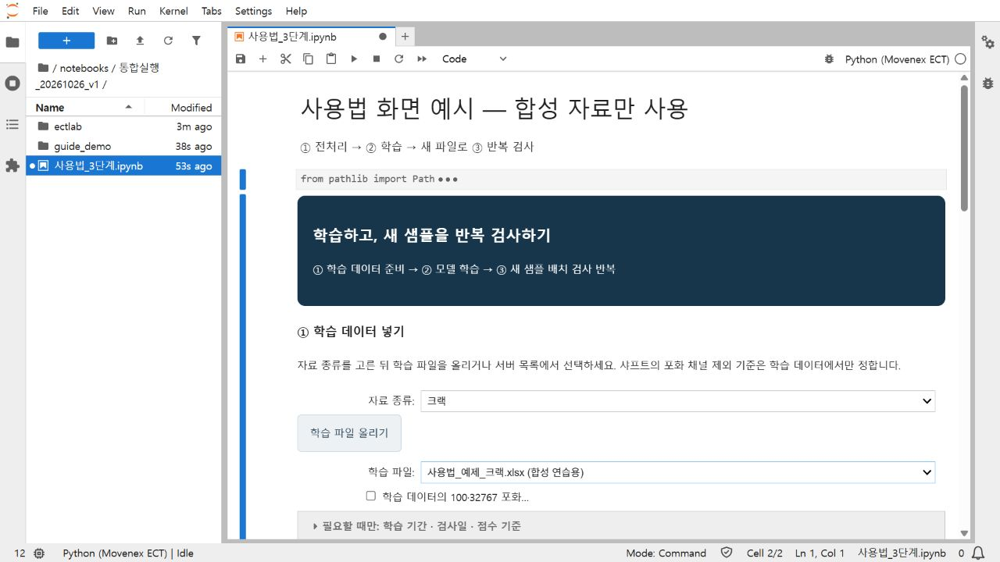

# 회사 PC에서 설치하고 실행하기

연구실 서버나 NAS에 연결하지 않고 회사 PC에서 기존 09번 노트북을 실행합니다. 데이터와 학습 모델·결과는 회사 PC에 저장됩니다.

## 준비

- Windows 10/11의 x64 PC와 인터넷 연결이 필요합니다.
- Python·VS Code·패키지 설치가 허용된 PC에서 실행하세요. 회사 보안 정책으로 설치가 막히면 전산 담당자의 확인이 필요합니다.
- 실제 데이터 포함 ZIP은 담당자에게 비공개로 받습니다. GitHub의 ZIP에는 합성 연습 자료만 있습니다.

## 처음 한 번 설치

1. ZIP을 `C:\Movenex`처럼 짧은 경로에 완전히 압축 해제합니다. ZIP 안에서 바로 실행하지 마세요.
2. `01_설치.cmd`를 더블클릭합니다.
3. VS Code도 설치할지 물으면 Enter를 누릅니다. 브라우저에서만 실행하려면 `n`을 입력합니다.
4. `설치 완료`가 나올 때까지 기다립니다. 처음에는 인터넷 속도에 따라 시간이 걸립니다.

설치 파일은 Python 3.12 64비트를 확인하고, 없으면 Python.org에서 공식 설치 파일을 받습니다. Jupyter와 분석 패키지는 프로그램 폴더의 `.venv`에 설치합니다. VS Code를 선택하면 Microsoft의 사용자용 설치 파일과 Python·Jupyter 확장도 준비합니다. 받은 Python·VS Code 설치 파일은 디지털 서명이 유효하고 발행자가 맞는지 확인한 후 실행합니다.

다른 Python 환경이나 NAS 설정은 변경하지 않습니다. 일반적인 사용자 설치를 사용하며 회사 정책에 따라 추가 권한이 필요할 수 있습니다. `.cmd`가 호출하는 PowerShell 실행 설정은 해당 설치 프로세스에만 적용하며 시스템 실행 정책을 바꾸지 않습니다.

XGBoost의 DLL을 불러오지 못하면 Microsoft Visual C++ 실행 구성요소도 공식 설치 파일로 준비합니다. 이 구성요소는 Windows 관리자 승인이나 재시작이 필요할 수 있습니다. 설치 후에도 모듈 검사를 통과해야 설치 완료로 표시합니다.

## 분석 시작

1. `02_분석실행.cmd`를 더블클릭합니다. 실행 창은 열어 두세요.
2. 브라우저에 09번 노트북이 열리면 위쪽 `Run → Run All Cells`를 한 번 누릅니다.
3. 자료 종류와 학습 파일을 고르고 `① 데이터 읽기 · 전처리`를 누릅니다.
4. `② 모델 학습`을 누릅니다.
5. 새 검사 파일을 올리고 `③ 새 샘플 배치 검사`를 누릅니다. 다음 파일도 ③번만 반복합니다.

위 사진은 합성 자료로 찍은 조작 예시입니다. 실제 자료 포함 패키지에서는 서버 파일 대신 PC의 실제 파일을 목록에서 선택합니다. 화면의 ‘서버 목록’ 표현도 실행 중인 회사 PC의 목록을 뜻합니다.

상세 조작은 [스크린샷 사용 설명서](통합테스트_가이드.md)를 참고하세요. 이 PC에서만 열리는 `127.0.0.1` 주소를 사용하므로 연구실 서버가 꺼져 있어도 실행됩니다. 다른 사람에게 이 주소를 전달해도 원격 접속 주소로 사용할 수는 없습니다.

## VS Code에서 실행할 때

VS Code에서 프로그램 폴더와 `notebooks/09_통합테스트_샘플별결과.ipynb`를 엽니다. 오른쪽 위 커널을 `Python (Movenex ECT)` 또는 해당 폴더의 `.venv\Scripts\python.exe`로 선택하고 전체 실행합니다. 브라우저로 실행할 때는 이 과정이 필요 없습니다.

## 새 데이터 파일을 추가할 때

1. `03_데이터추가_분석.cmd`를 더블클릭합니다.
2. 창에서 자료 종류를 고릅니다. C10·C80 열처리, 크랙, 샤프트 중 하나입니다.
3. `새 파일 선택 → 분석 화면 열기`를 누르고 새 CSV·Excel을 선택합니다. 여러 파일도 선택할 수 있습니다.
4. 원본을 바꾸지 않고 프로그램 폴더에 복사합니다. 같은 이름의 다른 파일이 있으면 새 이름으로 보존합니다.
5. 브라우저에서 `Run → Run All Cells`를 누릅니다. 추가한 첫 파일이 선택된 상태로 같은 3단계 화면이 열립니다.
6. 학습 파일과 검사 파일을 확인하고 ① → ② → ③ 순서로 실행합니다. 새 자료로 만든 별도 실행 화면이므로 기존 화면의 학습 상태를 가져오는 방식은 아닙니다.

이미 학습한 모델로 새 샘플만 검사하려면 열려 있는 기존 화면에서 `③ 새 검사 파일 올리기`를 사용하세요. 그러면 학습 상태를 유지하고 ③번만 반복할 수 있습니다. 03번은 새로운 파일을 추가해 분석을 새로 시작하는 용도입니다.

## 파일과 결과

| 위치 | 내용 |
|---|---|
| `data/private` | 실제 회사 데이터. 공개 GitHub에 올리지 않습니다. |
| `notebooks/전체실행_자료.json` | 실제 데이터 포함 패키지의 파일 목록. 상대 경로로 연결됩니다. |
| `results/학습모델_실행시각` | 학습 모델과 벡터 CSV 입력 양식 |
| 학습 폴더 안의 `검사결과` | 배치별 판정 CSV·PCA·HTML 보고서·ZIP |
| `logs` | 설치 중 문제가 생겼을 때 전달할 로그 |

실제 데이터가 포함된 패키지는 C10A·C80B 표준 CSV와 크랙·샤프트 Excel을 제공합니다. 새 자료는 09번에서 직접 올릴 수 있습니다. 결과는 후보 예측이며 현장 확인이 필요합니다. 모델 학습에 사용한 파일을 다시 검사한 결과는 독립 성능 검증으로 보지 않습니다.

## 설치가 중간에 멈추면

`logs/install-날짜-시각.txt`를 담당자에게 전달하세요. 인터넷·프록시·백신·프로그램 설치 정책을 확인해야 할 수 있습니다. 설치가 완료되지 않았는데 분석부터 실행하지 마세요. 문제가 해결되면 `01_설치.cmd`를 다시 실행할 수 있습니다. 이미 정상 설치된 Python과 가상환경은 재사용합니다.

설치 후 프로그램 폴더를 다른 위치로 옮기면 가상환경 경로가 달라질 수 있습니다. 새 위치에 원본 ZIP을 다시 풀고 설치하는 방법을 권장합니다.

공식 설치·사용 참고: [Python 3.12.10](https://www.python.org/downloads/release/python-31210/), [VS Code Windows 설치](https://code.visualstudio.com/docs/setup/windows), [확장 설치 명령](https://code.visualstudio.com/docs/configure/command-line).
